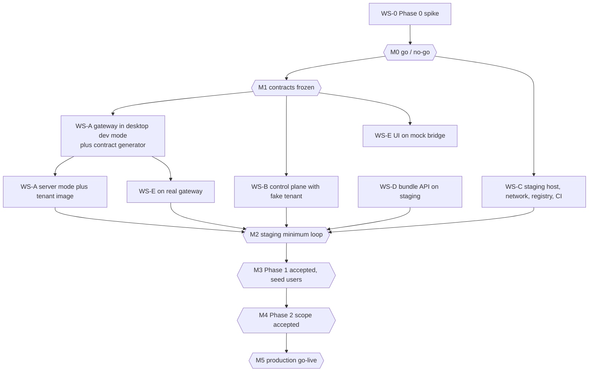

# 00 — Program Plan

How the cloud and mobile release is split into workstreams, who depends on
whom, when each milestone is due, and how work is accepted. Every party reads
this document first.

## Workstreams

| ID | Workstream | Party | Where the work lives | Main deliverables |
|----|------------|-------|----------------------|-------------------|
| WS-0 | Phase 0 Linux headless spike | External agent | IDBots repo, branch `spike/linux-headless` | Report, `results.json`, sizing numbers |
| WS-A | IDBots server mode and gateway | IDBots development party | IDBots repo: `src/main/server/`, `src/main/gateway/`, `src/main/ipc/`, `scripts/generate-ipc-contract.mjs`, `cloud/conformance/`, `deploy/tenant-image/` | Server mode, IPC registry, gateway, contract generator, conformance kit, tenant image |
| WS-B | Control plane | Control-plane development party (new) | IDBots repo: `cloud/control-plane/` (own pnpm package) | Invites, SMS login, provisioning, proxy, admin CLI |
| WS-C | Infrastructure and operations | Operations agent | IDBots repo: `deploy/` and `deploy/runbooks/`; Alibaba Cloud console | Hosts, network isolation, TLS, registry, CI, backups, monitoring |
| WS-D | Metaso bundle billing | Metaso team | Metaso `assist-open-api` repository | Bundle plans and orders, identity-bound LLM quota, partner IP policy |
| WS-E | Mobile client | Mobile development party | IDBots repo: `src/mobile/`, `vite.mobile.config.ts`, `mobile-shell/` | Mobile web app, `window.electron` shim, Android and iOS shells |
| ACC | Acceptance | Owner plus the planning agent | `docs/cloud-mobile/` | Reviews, end-to-end runs, sign-off |

One party may take several workstreams (for example WS-A and WS-E). The
documents stay separate so the work can still be reassigned.

## Dependencies

What can start immediately, before M0:

- WS-D: the bundle product does not depend on the spike.
- WS-C procurement: domain, SMS signature and template approval, Apple
  Developer account, container registry. These have lead times of days.
- WS-B: design and skeleton against a fake tenant (C1 health and readiness
  endpoints plus a C2 echo server), which WS-B builds itself.
- Owner decisions listed at the end of this document.

What must wait for M0:

- WS-A server-mode implementation (the display mode and any required app
  changes come from the spike).
- WS-C production host sizing (users per host and memory limit come from the
  spike).

## Mock-First Rule

Every party unblocks itself with a mock before the real dependency exists, as
the repository rules require:

| Party | Mock | Replaced by |
|-------|------|-------------|
| WS-B | Fake tenant container (health, readiness, WebSocket echo) | WS-A tenant image |
| WS-E | Mock bridge: `window.electron` backed by fixtures and timers | WS-A gateway in desktop dev mode, then staging |
| WS-A | Bundle IPC channels against a local stub of the C4 API | WS-D staging |
| WS-D | `mock` payment gateway on staging | Real Alipay on production |

## Milestones

Weeks are counted from the day the Phase 0 agent starts. Estimates assume one
to two engineers plus AI per party and are recalibrated at M0 and M2.

| Milestone | Target | Exit criteria | Accepted by |
|-----------|--------|---------------|-------------|
| M0 Go / no-go | End of week 1 | Phase 0 report delivered; verdict GO or GO_WITH_CONDITIONS; `tenantMemoryLimitMB` and `usersPerHost` measured | Owner |
| M1 Contracts frozen | End of week 2 | `01` and `02` updated with Phase 0 numbers, reviewed by WS-A, WS-B, WS-D, WS-E; version 1.0.0 tagged in the document header | Owner plus every party |
| M2 Staging minimum loop | End of week 4 | On staging: invite sign-up, provisioning, chat with a skill, scheduled task with the phone closed, bundle purchase through the mock gateway (scenarios A-01 to A-08 and A-11 with mock payment in `60`) | Acceptance |
| M3 Phase 1 accepted | End of week 5 | Phase 1 scenarios pass on staging with real Alipay; security checklist items marked Phase 1 pass; ten seed users invited | Owner |
| M4 Phase 2 accepted | End of week 7 | Gig Square, group tasks, private chat, mnemonic export, Android APK, iPhone TestFlight, daily backups with a restore drill (scenarios A-13 to A-23) | Acceptance |
| M5 Production go-live | End of week 8 | Go-live checklist in `60` complete; production host live; first invite batch sent | Owner |

Phase 1 scope is chat, MetaBot management, skills, scheduled and long-term
tasks, balance and recharge (allowlist tier P1). Phase 2 adds Gig Square,
Buzz and private chat, group tasks, mnemonic export, native shells, and
backups (tier P2).

## Environments

| Environment | Purpose | Where | Data |
|-------------|---------|-------|------|
| Local | Development | Developer machines; desktop IDBots with the gateway in dev mode (`IDBOTS_GATEWAY_DEV=1`) | Developer test identities |
| Staging | Integration and acceptance | Hong Kong host, about 4 vCPU / 16 GB; `staging.{APP_DOMAIN}`; Metaso staging; mock and real Alipay (real only with a ¥0.01 test plan) | Test identities only; may be wiped by the owner's decision |
| Production | Users | Hong Kong host sized from Phase 0, starting at 8 vCPU / 32 GB; `app.{APP_DOMAIN}`; Metaso production | User data; never wiped |

`{APP_DOMAIN}` is the domain the owner chooses (see Owner Decisions).

## Procurement and Accounts

Owner (or WS-C on the owner's behalf) opens these. Lead times are typical.

| Item | Needed by | Lead time | Notes |
|------|-----------|-----------|-------|
| Domain and DNS (`app.` and `staging.` records) | M2 | Same day | No ICP filing needed for a Hong Kong-hosted site |
| Staging ECS host in Hong Kong, about 4 vCPU / 16 GB, 200 GB ESSD | M2 | Same day | |
| Production ECS host in Hong Kong, size from Phase 0 | M3 | Same day | Encrypted ESSD data disk |
| OSS bucket in Hong Kong (backups) | M4 | Same day | Server-side encryption, versioning, lifecycle rule |
| Container Registry (ACR) in Hong Kong | M2 | Same day | Private namespace `idbots` |
| Alibaba Cloud SMS: signature and templates (login code, re-verification code) | M2 | Several business days | Signature must belong to the company entity; mainland numbers require approval |
| RAM sub-accounts with least privilege (SMS send, OSS write, ACR push and pull) | M2 | Same day | No root AccessKey on any host |
| Apple Developer Program (company) | M4 | Days to weeks (D-U-N-S) | Needed for TestFlight |
| Android signing keystore | M4 | Same day | Stored offline by the owner, backup copy in a password manager |
| Feishu or DingTalk group webhook for alerts | M2 | Same day | |
| Alipay merchant (face-to-face payment) | Already on Metaso | — | Confirm it can serve the bundle product |

## Secrets Register

| Secret | Created by | Stored in | Used by | Rotation |
|--------|-----------|-----------|---------|----------|
| Per-tenant gateway secret | WS-B at provisioning | Control-plane database, encrypted with the control-plane master key | Control plane → tenant | On demand (restart tenant with a new secret) |
| Control-plane master key | WS-C | Host environment file readable only by root; offline copy with the owner | Control plane | Yearly, with re-encryption |
| Control-plane session signing material | WS-B | Control-plane database (hashed tokens) | Control plane | Not applicable (tokens are random and hashed) |
| SMS AccessKey | WS-C | Host environment file | Control plane | Yearly |
| OSS backup AccessKey | WS-C | Host environment file | Backup job | Yearly |
| ACR pull credential | WS-C | Docker credential store on hosts | Docker | Yearly |
| ACR push credential | WS-C | CI secret store | CI | Yearly |
| Alipay merchant keys | Metaso | Metaso servers | WS-D | Per Metaso policy |
| Partner credential for Metaso (if WS-D chooses one) | WS-D | Tenant image environment via control plane | Tenants | Yearly |
| Apple and Android signing | Owner | Offline | WS-E release builds | Per store rules |

No secret is committed to any repository. Tenant containers never receive the
control-plane master key, SMS keys, or OSS keys.

## Change Control

The contracts (`01`) and the allowlist (`02`) carry a semantic version in
their header. After M1:

1. A party that needs a change writes a change request (CR) in the shared
   tracker: ID `CR-<n>`, contract and section, current text, proposed text,
   reason, affected parties, compatibility (backward compatible or breaking).
2. Affected parties answer within one business day.
3. The owner approves or rejects. Backward-compatible additions bump the minor
   version; breaking changes bump the major version and need a migration note.
4. The document is updated in the same change that implements it, and the
   gateway's `welcome` frame reports the new `contractVersion`.

Allowlist changes that only add channels are minor changes. Removing a channel
or changing its arguments is a breaking change.

## Delivery and Acceptance Process

Each workstream document lists its requirements (`REQ-<ws>-<n>`) and
acceptance criteria (`AC-<ws>-<n>`). A delivery is accepted when:

1. The branch or release named in the workstream document is available to the
   reviewer, with all of the repository's verification gates passing.
2. A delivery note lists each requirement with its status and evidence (test
   names, logs, screenshots, or recordings).
3. The reviewer runs the acceptance criteria. Defects are rated S1 (blocks a
   scenario or loses data), S2 (wrong behavior with a workaround), S3 (cosmetic
   or minor). A delivery with an open S1 or S2 is not accepted.
4. The owner signs off in `60-acceptance-and-go-live.md`.

## Communication

- One shared tracker (for example GitHub issues in the IDBots repository) with
  labels `ws-a` … `ws-e`, `contract`, `cr`, `defect-s1` … `defect-s3`.
- Contract questions are answered within one business day by the contract
  owner: C1 and C2 by WS-A, C3 by WS-B, C4 by WS-D.
- A weekly status note per party: done, next, blocked, risks.

## Risk Register

| Risk | Likelihood | Impact | Mitigation | Owner |
|------|------------|--------|------------|-------|
| Electron headless or skills fail on Linux | Medium | High | Phase 0 gates everything; fixed fallback ladder (Xvfb, then Ozone, then app patches) | WS-0, WS-A |
| Per-user memory higher than planned | Medium | Medium | Phase 0 measurement; server mode drops the renderer window; memory limit per tenant | WS-A, WS-C |
| Metaso per-IP limits block onboarding from the shared egress IP | High | High | Partner IP policy in C4 (REQ-D-6) agreed before M2 | WS-D |
| SMS signature approval delayed | Medium | High | Apply in week 1; staging can use a fixed test code for allowlisted test numbers | Owner, WS-C |
| Apple rejects a thin wrapper later | Medium | Low for this release | TestFlight only; native features before any App Store submission | WS-E |
| App Store rules on paying for digital goods outside in-app purchase | High for iOS shells | Medium | The iOS shell hides recharge; iPhone users recharge in the web app (WS-E REQ-E-15) | WS-E |
| Alipay does not accept paying a 当面付 code on the same phone | Medium | High | Confirm with Alipay before M3 (WS-D REQ-D-19); fallback is 手机网站支付, which needs ICP filing | WS-D, Owner |
| WeChat and QQ in-app browsers block the Alipay hand-off or warn on the domain | High | Medium | Login page detects them and guides the user to the system browser (WS-E REQ-E-10) | WS-E |
| HarmonyOS NEXT phones cannot install the APK | Medium | Low | These users use the web app | WS-E |
| Custodial exposure (keys in tenant SQLite) | Low | High | Small balances, traffic sponsorship, encrypted disks, restricted operator access, mnemonic export exit | WS-A, WS-C |
| Cross-border personal data (mainland users, Hong Kong storage) | Medium | High | Legal review of the privacy policy and consent flow before M5 | Owner |
| IPC surface exposes a dangerous channel | Low | High | Deny by default; allowlist tests; security review at M3 | WS-A, ACC |
| Host failure loses tenant data | Low | High | Daily snapshots plus per-tenant OSS backups; restore drill before M5 | WS-C |
| A party's delivery slips and blocks the critical path | Medium | Medium | Mock-first rule; weekly status; owner reassigns early | Owner |

## Owner Decisions Needed

| Decision | Needed by | Default if not decided |
|----------|-----------|------------------------|
| `{APP_DOMAIN}` and the app's display name | M2 | `app.idbots.ai`-style subdomain of an owned domain; display name "IDBots" |
| Bundle plans and prices (traffic bytes plus LLM quota per plan) | M2 | One test plan at ¥0.01 on staging; two plans proposed by WS-D for production |
| Trial amounts per invite (traffic and LLM quota) | M2 | Existing free grant plus the existing free LLM quota |
| Size of the first invite batch | M3 | Ten seed users, then fifty |
| Privacy policy, terms, and custodial disclosure texts | M3 | No production launch without them |
| Entity for the SMS signature and the Apple account | Week 1 | Company entity |
| Support channel shown in the app | M3 | A Feishu or WeChat group link |
| ICP filing for a mainland-facing domain (only if Alipay rejects same-phone 当面付) | M3 | Not filed; keep 当面付 |
