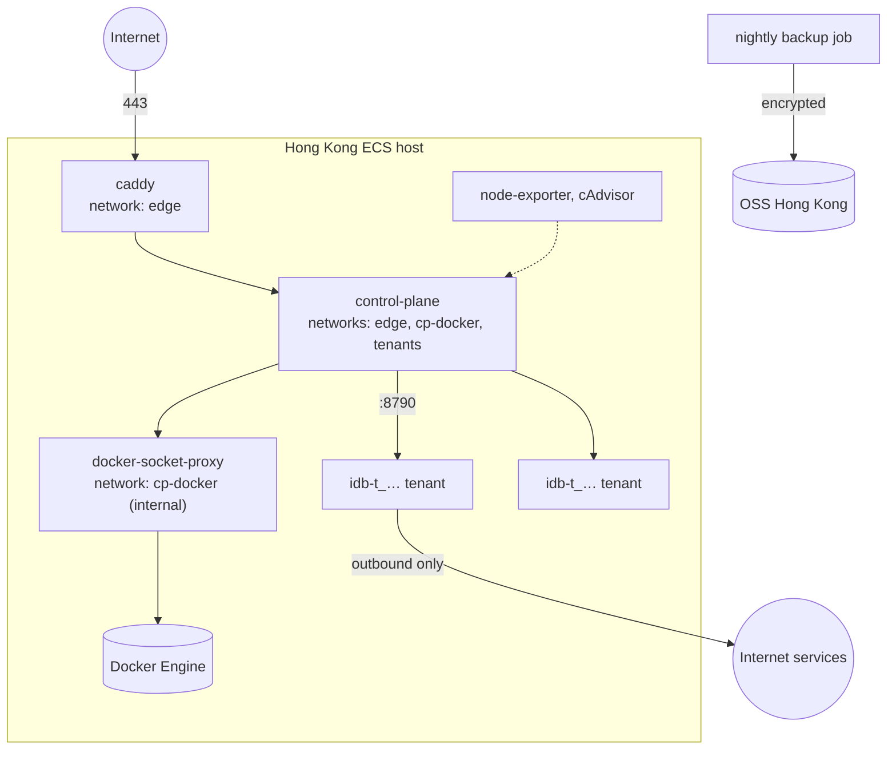

# 30 — WS-C: Infrastructure and Operations

**Party:** operations agent (with the owner's Alibaba Cloud access).
**Repository:** IDBots, directories `deploy/` and `deploy/runbooks/`, plus a
CI workflow in `.github/workflows/`. **Runs:** C1 tenant containers (created
by the control plane), the WS-B control plane, and the edge.
**Consumers:** every party (staging and production environments).

## Goal

Two Hong Kong environments (staging and production) where the control plane
can create isolated tenant containers, the phone reaches the service over
HTTPS, images are built and scanned automatically, data is backed up and
restorable, and failures raise alerts.

## Background You Need

- `00-program-plan.md` (environments, procurement, secrets register),
  `01-interface-contracts.md` C1 (tenant settings) and C3 (public origin),
  `20-ws-b-control-plane.md` (configuration variables).
- Phase 0 report: `tenantMemoryLimitMB`, `usersPerHost`, image size, network
  findings.
- The repository's `AGENTS.md`: anything committed to the IDBots repository
  follows its branch, commit, and pnpm rules; no secrets in git.

## Host Topology



| Network | Members | Notes |
|---------|---------|-------|
| `edge` | caddy, control-plane | Only Caddy publishes ports (80, 443) |
| `cp-docker` | control-plane, docker-socket-proxy | `internal: true` |
| `tenants` | control-plane (fixed IP), every tenant | Fixed subnet, for example `172.30.0.0/16`, control plane at `172.30.0.2` |

## Requirements

### Hosts

- **REQ-C-1** Staging: about 4 vCPU / 16 GB. Production: size from Phase 0
  (`usersPerHost` for the first 50 users plus 30% headroom), starting at
  8 vCPU / 32 GB. Region `cn-hongkong`. Ubuntu 24.04 LTS or Alibaba Cloud
  Linux 3. Encrypted ESSD data disk mounted at `/var/lib/docker`. cgroup v2.
  Docker CE stable with the `overlay2` driver and the `json-file` log driver
  defaults from C1.
- **REQ-C-2** Docker daemon `dns` set to public resolvers reachable from
  containers (for example `223.5.5.5`, `223.6.6.6`) so tenant DNS does not
  depend on the metadata-range resolvers blocked in REQ-C-6.
- **REQ-C-3** Security group: inbound 80 and 443 from anywhere; 22 only from
  the owner's listed IPs; nothing else. SSH keys only, no password or root
  login, `fail2ban`, automatic security updates, `auditd` for sudo.
- **REQ-C-4** A fixed Elastic IP per host for outbound traffic. Publish the
  production and staging egress IPs to WS-D (C4 partner policy) before M2.

### Edge and TLS

- **REQ-C-5** Caddy terminates TLS for `app.{APP_DOMAIN}` (production) and
  `staging.{APP_DOMAIN}` (staging) with automatic certificates, redirects HTTP
  to HTTPS, sets HSTS (`max-age=31536000`), limits request bodies to 26 MB,
  keeps WebSocket connections open without an idle timeout, and proxies
  everything to `control-plane:8080`. Access logs are JSON and redact the path
  after `/files/` (tokens grant short-lived access). Reference configuration,
  with the environment variable `APP_HOST` set to `app.{APP_DOMAIN}` or
  `staging.{APP_DOMAIN}` in the compose file:

  ```caddyfile
  {$APP_HOST} {
    encode zstd gzip
    header Strict-Transport-Security "max-age=31536000"
    request_body {
      max_size 26MB
    }
    reverse_proxy control-plane:8080 {
      flush_interval -1
      transport http {
        read_timeout 0
        write_timeout 0
      }
    }
    log {
      output stdout
      format filter {
        wrap json
        fields {
          request>uri regexp ^/files/.* /files/REDACTED
        }
      }
    }
  }
  ```

### Network Isolation

- **REQ-C-6** Rules in the `DOCKER-USER` chain (persisted by a systemd unit
  that runs after Docker starts; traffic inside one bridge network reaches
  this chain only while `net.bridge.bridge-nf-call-iptables=1`, so check that
  setting too), in this order:
  1. Accept established and related traffic.
  2. Accept new connections from the control plane's fixed IP to the tenant
     subnet on TCP 8790.
  3. Drop new connections between any two addresses in the tenant subnet
     (tenant to tenant, tenant to control plane).
  4. Accept DNS (UDP and TCP 53) from the tenant subnet to the resolvers set
     in REQ-C-2.
  5. Drop traffic from the tenant subnet to `100.100.100.200` (metadata),
     `169.254.0.0/16`, `10.0.0.0/8`, `172.16.0.0/12`, `192.168.0.0/16`,
     `100.64.0.0/10`, and the host's own addresses.
  6. Accept everything else from the tenant subnet (outbound internet).
- **REQ-C-7** The control plane reaches Docker only through
  `docker-socket-proxy` (for example `tecnativa/docker-socket-proxy`) with
  only `CONTAINERS`, `IMAGES`, `NETWORKS`, `VOLUMES`, and `POST` enabled; `EXEC`,
  `BUILD`, `SWARM`, `SYSTEM`, `PLUGINS`, and `SECRETS` disabled. The raw
  socket is mounted into no other container.

### Registry and CI

- **REQ-C-8** Alibaba Cloud Container Registry in Hong Kong, private namespace
  `idbots`, repositories `tenant` and `control-plane`. Keep the last 20 tags
  plus every tag currently deployed. Pull credentials on hosts; push
  credentials only in CI secrets.
- **REQ-C-9** CI workflow `.github/workflows/cloud-images.yml` (next to the
  existing `build.yml`), triggered by tags `cloud-v*` and manually:
  1. Builds `deploy/tenant-image/Dockerfile` and
     `cloud/control-plane/Dockerfile` for `linux/amd64`.
  2. Scans both with Trivy; fails on CRITICAL vulnerabilities that have a fix.
  3. Starts the tenant image and runs WS-A's conformance kit against it.
  4. Pushes `{version}-{commit7}` tags to the registry.
  The workflow uses `pnpm install --frozen-lockfile` wherever it installs
  dependencies, never `npm install`.

### Deployment

- **REQ-C-10** `deploy/hosts/compose.yml` runs caddy, control-plane,
  docker-socket-proxy, node-exporter, and cAdvisor with restart policy
  `unless-stopped`. Tenants are not in the compose file (the control plane
  creates them). `deploy/hosts/cp.env.example` lists every WS-B variable with
  placeholder values; the real file is `/etc/idbots/cp.env`, mode `0600`,
  owned by root, never committed.
- **REQ-C-11** The control-plane SQLite database and Caddy's data directory
  live on named volumes that survive `compose down`.
- **REQ-C-12** Updating the control plane (`docker compose pull` then
  `docker compose up -d control-plane`) does not restart tenants.

### Backups

- **REQ-C-13** Automatic snapshots of the data disk daily, keeping 7 daily
  and 4 weekly snapshots.
- **REQ-C-14** Nightly per-tenant backups between 03:00 and 05:00
  Asia/Shanghai, staggered: a crash-consistent copy of the tenant volume,
  compressed, encrypted, and uploaded to OSS. The container may be paused for
  at most 60 s; for example, copy the volume with `rsync` while it runs, then
  `docker pause`, run `rsync` again for the changes, `docker unpause`, and
  archive the copy. Objects go to `tenants/{tenantId}/{yyyy-mm-dd}.tar.zst.enc`
  and are kept 30 days. The control-plane database is backed up nightly with
  SQLite's online backup to `control-plane/{yyyy-mm-dd}.sqlite.zst.enc`. A
  failed backup raises an alert.
- **REQ-C-15** Restores: a script restores one tenant from a chosen backup
  into a new volume, starts the tenant on it through the control-plane CLI,
  and checks `PRAGMA integrity_check`. The full-host restore (from disk
  snapshot) is documented and tested once on staging before M5.

### Monitoring and Alerts

- **REQ-C-16** Metrics from node-exporter, cAdvisor, and the control plane's
  `/metrics`, collected by Prometheus with Alertmanager or by Alibaba Cloud
  CloudMonitor. Alerts go to the Feishu or DingTalk webhook:
  - host memory above 85% for 10 minutes, disk above 80%;
  - a tenant restarting more than 3 times in 15 minutes, any tenant in
    `failed`, any OOM kill;
  - control-plane `/health` failing for 2 minutes; 5xx above 2% for 5 minutes;
  - TLS certificate expiring within 14 days;
  - a backup failure;
  - tenants at 80% of the host's `capacity`.
- **REQ-C-17** An external uptime check on `https://app.{APP_DOMAIN}/health`
  from at least two mainland probe locations, recording latency.
- **REQ-C-18** Container logs rotate per C1. Control-plane logs are kept 30
  days. Tenant logs are not shipped off the host in v1.

### Capacity

- **REQ-C-19** Set each host's `capacity` in the control-plane `hosts` table
  to the Phase 0 `usersPerHost` for that host size. Provisioning beyond
  capacity is refused by the control plane and raises the 80% alert first.

### Security Operations

- **REQ-C-20** Operators use named accounts. Access to a tenant volume (for
  support, export, or deletion) follows the runbook and is recorded in the
  control-plane audit log through the CLI. No operator reads `idbots.sqlite`
  contents without a written user request.
- **REQ-C-21** Secrets are created and stored as listed in the secrets
  register (`00`). Nothing secret is in git, in compose files, or in CI logs.
- **REQ-C-22** A monthly patch window: host updates, rebuilt images on the
  latest base image, Trivy re-scan of deployed tags.

## Runbooks (Deliverables)

Write each as a step-by-step document in `deploy/runbooks/` that another
operator can follow without help:

| Runbook | Covers |
|---------|--------|
| `host-bootstrap.md` | From a fresh ECS host to a running edge and control plane, including REQ-C-2 to C-7 |
| `deploy-control-plane.md` | Updating the control plane; rollback to the previous tag |
| `tenant-image-rollout.md` | Canary on one staging tenant, then `tenant upgrade --all`; rollback rules from C1 |
| `backup-and-restore.md` | Nightly job, single-tenant restore, full-host restore, restore drill record |
| `incident-response.md` | Tenant failed, host memory pressure, control plane down, SMS provider failure, Metaso outage, suspected compromise |
| `secret-rotation.md` | Gateway secrets, master key, SMS, OSS, and registry credentials |
| `user-data-export-and-deletion.md` | Handling a deletion request end to end with the CLI |
| `add-host.md` | Adding a second host and registering it in `hosts` |
| `staging-reset.md` | Wiping staging test data, only with the owner's written approval |

## Deliverables

1. Staging environment live by M2, production by M3 (empty) and ready for
   users by M5.
2. `deploy/` contents (compose file, env example, Caddyfile, firewall unit,
   backup and restore scripts) and the runbooks, on a branch following
   `AGENTS.md`.
3. The CI workflow producing scanned images.
4. A delivery note with evidence for each acceptance criterion.

## Acceptance Criteria

- **AC-C-1 Isolation.** From inside a tenant: a request to another tenant's
  port 8790 fails; requests to `100.100.100.200`, a `10.x` address, and the
  host address fail; `https://api.deepseek.com` and
  `https://www.metaso.network` succeed; DNS resolves. From the control plane, a
  tenant's `/healthz` answers.
- **AC-C-2 Edge.** HTTP redirects to HTTPS; HSTS present; an SSL Labs grade of
  A or better; a WebSocket through the edge stays connected for 30 idle
  minutes with keepalive; a 25 MB upload passes and a 27 MB upload is refused.
- **AC-C-3 CI.** Pushing a `cloud-v*` tag produces both images, scanned and
  pushed, with the conformance kit passing.
- **AC-C-4 Reboot.** A host reboot brings back Caddy, the control plane, the
  firewall rules, and every tenant without manual steps within 10 minutes.
- **AC-C-5 Backup and restore.** The nightly job completes for every tenant;
  a restore drill of one staging tenant into a new container lets that user
  log in and see their MetaBots, sessions, and files, with
  `PRAGMA integrity_check` returning `ok`, in under 30 minutes.
- **AC-C-6 Alerts.** Each alert rule in REQ-C-16 is triggered once on staging
  and reaches the webhook.
- **AC-C-7 Latency.** The uptime check reports P95 round-trip time from the
  mainland probes; the number is recorded in the go-live checklist.

## Out of Scope

Application logic (WS-A, WS-B), Metaso servers (WS-D), app store
distribution (WS-E), Kubernetes, multi-region deployment.
