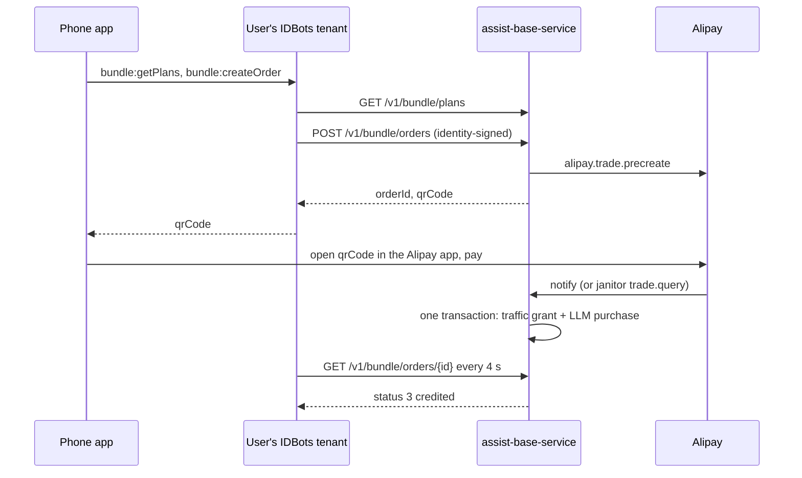

# 40 — WS-D: Metaso Bundle Product

**Party:** `assist-base-service` team (Go, Gin, GORM, MySQL), deployed behind
`https://www.metaso.network/assist-open-api`.
**Repository:** `assist-base-service` (the IDBots team does not modify it).
**Contract:** `01-interface-contracts.md` section C4 (this document explains
it; if they disagree, C4 wins and the difference is raised as a change
request). **Consumers:** WS-A (IDBots main-process facades `bundle:*`),
WS-E (Me tab and recharge screen).

## Goal

A mobile user tops up once and that single payment covers both LLM usage and
on-chain traffic. The LLM quota belongs to the user's identity, survives a
rebuilt tenant, and tells the app clearly when it runs out. Many new users
arriving from the same Hong Kong egress IP are not blocked by per-IP limits.

## Background You Need

You already delivered the pieces this builds on:

| Delivered piece | Reference |
|-----------------|-----------|
| Traffic accounts, ledger, pricing plans, recharge orders, admin console | `docs/gasfee-flow/backend-spec.md` v1.1 |
| Free grant and single-use redeem codes | `docs/gasfee-flow/backend-spec-v2.md` |
| PayPal gateway seam and webhook route `POST /v1/traffic/payment/webhook/:gateway` | `docs/gasfee-flow/phase4-paypal-backend-requirements.md` |
| Alipay 当面付 gateway, notify verification, `trade.query` janitor, expiry with `trade.close` | `docs/gasfee-flow/phase5-alipay-backend-requirements.md` |
| Free LLM relay: `POST /v2/assist/llm/bootstrap`, `GET /v2/assist/llm/quota`, OpenAI-compatible chat, JEV, and vision routes sharing one quota | "LLM 免费额度对接文档" |

Conventions stay as they are: envelope `{ code, message, data }`, identity
headers `X-Identity-Address`, `X-Timestamp` (unix seconds, ±300 s),
`X-Signature` (Bitcoin signed message, base64), canonical messages in
`service/traffic_service/message.go`, idempotent `sql/update.sql` migrations.

Phase 0 observations for this team:

- The free LLM allowance is per identity, about 4.8 million units. S05b used
  one up with four skills (web-search, weather, docx, xlsx). A second
  bootstrap of an exhausted identity returns the same empty pool.
- Onboarding writes the twin on-chain through the gas sponsor. While the
  sponsor was unreachable, chain setup stayed pending and the empty wallet
  could not pay on its own. IDBots retries (WS-A REQ-A-8); the sponsor side
  needs to accept that retry when it recovers, without a new identity.

## How the Pieces Fit

The tenant (a full IDBots instance) holds the identity key and signs every
request; the phone never talks to `assist-base-service` directly.

## Requirements

### Plans

- **REQ-D-1 Table.** `tb_bundle_plan`: `plan_id` (unique), `name`, `name_en`,
  `pay_currency`, `pay_amount` (DECIMAL(12,2)), `traffic_bytes`
  (BIGINT UNSIGNED), `llm_quota` (BIGINT UNSIGNED), `llm_quota_unit`
  (`tokens`), `status` (1 on sale, 0 off), `sort`, `remark`, timestamps.
  Created by an idempotent migration.
- **REQ-D-2 Public list.** `GET /v1/bundle/plans` exactly as C4: on-sale plans
  ordered by `sort`, amounts as decimal strings, no signature.
- **REQ-D-3 Seed plans.** The owner sets live values (see Owner Decisions).
  Seed two or three regular plans and one acceptance plan priced ¥0.01 that is
  on sale only during acceptance runs. CNY only in v1.

### Orders and Crediting

- **REQ-D-4 Storage.** Bundle orders get ids with the prefix `bo_` and store a
  snapshot of the plan at creation (`pay_amount`, `pay_currency`,
  `traffic_bytes`, `llm_quota`), `account_id`, `identity_address`,
  `gateway`, `gateway_txn_id` (unique), `status` (1 created, 2 paid,
  3 credited, 4 closed), `paid_at`, `credited_at`, `closed_at`. You may use a
  new `tb_bundle_order` table or extend `tb_traffic_recharge_order` with an
  order kind and `llm_quota`; either way the existing recharge API and its
  responses stay unchanged.
- **REQ-D-5 Create.** `POST /v1/bundle/orders` as C4: verify the signature over
  `bundle-order:{accountId}:{planId}:{timestamp}` where `accountId` is the
  caller's traffic account; reject plans that are not on sale; build the
  Alipay precreate request only from the plan row (`total_amount` as a
  two-decimal string, `subject` such as `IDBots 套餐 {name}`,
  `out_trade_no` = `orderId`). `gateway: "mock"` works only when
  `traffic.mock_payment_enabled` is on. A disabled gateway returns the same
  envelope error as the recharge path. At most 5 bundle orders per account
  are created in any 30 minutes; a sixth is refused with an envelope error.
- **REQ-D-6 Partner policy for the Hong Kong egress.** All IDBots tenants
  reach you from the egress IPs WS-C publishes (one per host, staging and
  production listed separately). Per-IP limits on LLM bootstrap, traffic
  account creation, free-grant claims, and sponsored gas must allow at least
  50 new identities per day and 500 in total from those IPs. Per-identity
  limits stay in force. Choose the mechanism (a configured IP allowlist, a
  partner key sent as a header and stored in the tenant's
  `IDBOTS_METASO_PARTNER_KEY`, or both), write it into C4 as change request
  CR-1 before M2 (C4 is frozen at 1.0.0; CR-1 makes it 1.1.0), and show the
  daily count of new identities per partner IP in the admin console with an
  alert above 200 per day. Phase 0 observed no limit at 7 new identities from
  one Hong Kong IP; the requirement is about the 50-per-day scale, so state
  the current per-IP limits in the delivery note.
- **REQ-D-7 Status.** `GET /v1/bundle/orders/{orderId}` as C4 (no signature,
  like the recharge order status). It may run `alipay.trade.query` for a
  created Alipay order before answering, as the recharge status does.
- **REQ-D-8 Notify and janitors.** The existing Alipay notify URL and
  janitors handle bundle orders: correlation by `out_trade_no` = `orderId`
  (dispatch on the `bo_` prefix or the order kind), the full Phase 5
  verification (RSA2 signature, `app_id`, `seller_id`, `trade_status`), exact
  amount match against the snapshot, the `trade.query` reconciliation sweep,
  and the expiry sweep with `alipay.trade.close`.
- **REQ-D-9 Atomic, exactly-once crediting.** When a bundle order is verified
  paid (notify, reconciliation, or mock-confirm), in one database transaction:
  move the order to credited, write a traffic ledger `grant` entry
  (`source_type = bundle_order`, `source_id = orderId`) adding
  `traffic_bytes`, and write an LLM quota `purchase` entry adding `llm_quota`
  to the identity's pool. Both ledger rows have unique keys on
  `(source_type, source_id)` so duplicate notifies or races never credit
  twice. If the two balances live in different databases, use an outbox so
  both are applied exactly once; the order shows credited only after both
  are applied.

### LLM Quota

- **REQ-D-10 Identity-bound pool.** Free and purchased quota belong to the
  identity address. Every relay key issued by `bootstrap` for that identity
  draws from the same pool; a new bootstrap (for example after a tenant is
  restored from backup, or a key is revoked) returns access to the same
  pool, never a fresh one and never a loss of purchased quota. Phase 0
  confirmed this already holds for the free allowance (a second bootstrap of
  an exhausted identity returned `quotaRemaining: 0`, while a new identity
  on the same IP got a full allowance of about 4.8 million units); purchased
  quota must follow the same rule.
- **REQ-D-11 Consumption order.** Usage draws from the free part first, then
  the purchased part. Token counting stays as it is today.
- **REQ-D-12 Quota fields.** `GET /v2/assist/llm/quota` and the `bootstrap`
  response add `quotaFree`, `quotaPurchased`, and `unit: "tokens"`. Existing
  fields keep their meaning with `quotaTotal = quotaFree + quotaPurchased`
  (granted totals) and `quotaRemaining = quotaTotal - quotaUsed`.
- **REQ-D-13 Exhaustion signal.** Keep today's signal so desktop builds in
  the field keep working: when the pool is empty, the chat, JEV, and vision
  routes answer HTTP `429` with an OpenAI-style error body before any
  streamed bytes. The code stays `free_quota_exhausted` for an identity that
  has never had purchased quota, and is `quota_exhausted` once purchased
  quota is used up. A request already streaming when the pool runs out
  finishes normally (the pool may go slightly negative); the next request
  gets the `429`. A purchase that brings the pool back above zero makes the
  next request succeed without a new key.
- **REQ-D-14 LLM ledger.** `GET /v2/assist/llm/ledger` as C4, authenticated by
  the relay key or by identity headers over
  `llm-relay-ledger:{identityAddress}:{timestamp}`. `usage` items may be
  aggregated per day and model. Newest first, cursor pagination,
  `limit` at most 100.

### Redeem Codes for Invites

- **REQ-D-15** No change to redeem semantics: codes stay single-use. The
  admin console must generate a batch (for example 200 codes of a chosen
  `traffic_bytes`) and export it as CSV with one code per line; the control
  plane imports the file and gives each new user one code (WS-B
  `redeem_codes`). Revoking a batch must keep working.

### Staging and Admin

- **REQ-D-16 Staging instance.** A separate deployment with its own database,
  `traffic.mock_payment_enabled` on, the bundle plans seeded, real LLM routing
  with small free grants, and the staging egress IP under the partner policy.
  Most staging tests use the mock gateway; M3 needs real payments on staging,
  so staging also uses the live Alipay merchant (its own `notify_url`), with
  the ¥0.01 acceptance plan only. The Alipay sandbox stays available for
  development. Give WS-A and WS-B its base URL within the first week of
  WS-D work (target 2026-10-23; see `41`).
  Mock payments are impossible on production.
- **REQ-D-17 Admin console.** Bundle plan CRUD; bundle order list with
  filters (status, account, date) and the Alipay `trade_no`; revenue by day in
  CNY; a manual LLM quota adjustment per identity (signed amount, reason,
  idempotency key, recorded in the LLM ledger) so acceptance can drain or
  refill a test account; the partner IP counters from REQ-D-6.
- **REQ-D-18 Refunds.** No automatic refunds in v1 (same as Phase 5). The
  runbook is: refund in the Alipay merchant console, then a negative manual
  adjustment of traffic and LLM quota with the order id as the reason.

### Mobile Payment Path

- **REQ-D-19** The phone cannot scan a QR code shown on its own screen. The
  app opens the returned `qrCode` (`https://qr.alipay.com/…`) so the Alipay
  app takes over; WS-E implements the launch. Confirm with Alipay that
  paying a 当面付 code this way is allowed for this merchant, and record the
  answer in the delivery note. If it is not allowed, say so before M3; the
  fallback is Alipay 手机网站支付 (`alipay.trade.wap.pay`), which needs an
  ICP-filed domain (an owner decision).

## Deliverables

1. Code in `assist-base-service`, deployed to staging before M2 (with the mock
   gateway and the Alipay sandbox; dates in
   `41-ws-d-implementation-plan.md`) and to production by M3.
2. Swagger or Markdown API documentation for every new or changed endpoint,
   including the REQ-D-6 mechanism, also copied into C4.
3. Seeded plans on staging; the production plans once the owner sets values.
4. A delivery note listing each REQ-D item with evidence, plus any recorded
   deltas (as in the Phase 5 delivery notes).

## Acceptance Criteria

Run on staging first, then on production with the ¥0.01 acceptance plan.

- **AC-D-1 Plans.** `GET /v1/bundle/plans` lists exactly the on-sale plans in
  `sort` order; switching a plan off in the console removes it.
- **AC-D-2 Mock loop.** On staging, create a mock order, mock-confirm it, and
  see the order go `1 → 3`, the traffic balance rise by `trafficBytes`, and
  `quotaPurchased` rise by `llmQuota`, with one ledger row in each ledger.
- **AC-D-3 Alipay loop.** Pay a live ¥0.01 order: the order
  reaches `3` within 10 s of payment; both balances rise once; the Alipay
  `trade_no` is the gateway transaction id.
- **AC-D-4 Exactly once.** Replaying the notify, racing the janitor, and
  calling mock-confirm twice never credit twice.
- **AC-D-5 Tampering.** A bad signature, wrong `app_id`, wrong `seller_id`, or
  a `total_amount` different from the snapshot leaves the order uncredited.
- **AC-D-6 Lost notify.** With the notify blocked, the reconciliation sweep
  credits the order within one sweep interval.
- **AC-D-7 Identity pool.** Bootstrap twice for one identity (two keys): both
  keys report the same quota; after a purchase both see it; revoking one key
  and bootstrapping again keeps the purchased quota.
- **AC-D-8 Exhaustion.** Drain a test identity with the admin adjustment:
  the next chat, JEV, and vision requests return `429` with code
  `free_quota_exhausted`; after a mock purchase is used up they return code
  `quota_exhausted`; a purchase restores service on the next request with the
  same key.
- **AC-D-9 Ledger.** The LLM ledger shows the free grant, the purchase (with
  `orderId`), and usage, with working pagination and both auth methods.
- **AC-D-10 Partner policy.** A script creates 60 new identities in one day
  from the staging egress IP: all can bootstrap, create traffic accounts, and
  claim the free grant; the admin counter shows 60. The same script from a
  non-partner IP is limited as before.
- **AC-D-11 Redeem batch.** Generate and export 20 codes; the control plane
  imports them; 20 sign-ups each redeem exactly one code.
- **AC-D-12 Order limit and expiry.** A sixth order within 30 minutes is
  refused; an
  unpaid order closes in the expiry sweep and its QR is no longer payable.
- **AC-D-13 Mobile payment.** On an Android phone and an iPhone, opening the
  `qrCode` from the app completes payment in the Alipay app (or REQ-D-19's
  answer documents why not).
- **AC-D-14 Regression.** Existing traffic recharge (PayPal, Alipay, mock),
  free grants, redeem codes, sponsored writes, and desktop IDBots LLM usage
  behave as before.

## Owner Decisions

| Decision | Needed by |
|----------|-----------|
| Bundle plan names, prices, `trafficBytes`, and `llmQuota` | M1 (staging can start with placeholders) |
| Free LLM grant size for new identities in the mobile release (Phase 0: the current allowance of about 4.8 million units lasted about 17 turns including heavy skills; the free traffic grant is 60 MB per identity and one test Buzz used 616 bytes) | M1 |
| Redeem code value for invites | M2 |
| Fallback if 当面付 cannot be paid on the same phone (ICP filing for 手机网站支付) | M3 |

## Out of Scope

Subscriptions and auto-renewal, WeChat Pay, USD bundles, invoices, automatic
refunds, changes to how tokens are counted, any change to IDBots code.
