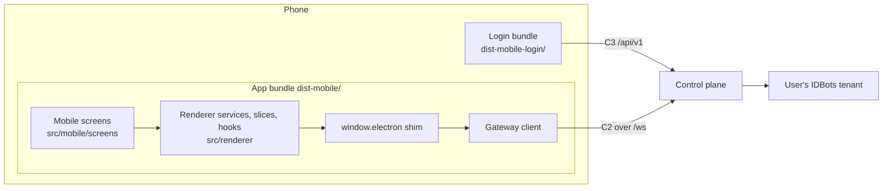

# 50 — WS-E: Mobile Client

**Party:** mobile development party.
**Repository:** IDBots: `src/mobile/`, `vite.mobile.config.ts`,
`mobile-shell/`, and small shared changes in `src/renderer/` (REQ-E-7).
**Contracts:** C2 (gateway), C3 (login and account API), `02` (which channels
exist), C4 through the `bundle:*` channels. **Depends on:** WS-A (contract
file, gateway, desktop dev mode), WS-B (login API, proxy), WS-D (plans and
payments, through WS-A).

## Goal

A phone app that feels like a chat app, runs the user's IDBots in the cloud
through `window.electron` calls over the gateway, and reuses the desktop
renderer's services and Redux slices so business logic is written once.

## Background You Need

- The spec `docs/superpowers/specs/2026-10-14-mobile-cloud-design.md`,
  sections "Mobile Client" and "Evolution Path to a Native App".
- The desktop renderer: React 18, Redux Toolkit, Tailwind 3, Vite 5, path
  alias `@/` → `src/renderer/`. Services in `src/renderer/services/` call
  `window.electron.*`, which the desktop preload (`src/main/preload.ts`)
  defines; its types are in `src/renderer/types/electron.d.ts`. Event
  subscriptions such as `skills.onChanged(callback)` return an unsubscribe
  function.
- Repository rules: functional components with hooks; logic in services,
  slices, and hooks, never in components; Tailwind with the CSS variables
  (`var(--bg-main)`, `var(--bg-panel)`, `var(--text-primary)`,
  `var(--color-primary)`), no `dark:` utilities; every user-facing string
  through `src/renderer/services/i18n.ts` in English and Chinese; no
  `window.confirm` or `window.alert`; English comments; strong typing; pnpm
  only.

## How the App Is Put Together

- The login bundle is served by the control plane at `/` and `/login`.
- The app bundle is built into the tenant image and served at `/app/`, so the
  UI always matches the backend version.
- The shim makes the renderer's existing services work unchanged: each
  `window.electron` method becomes a C2 `invoke`, and each `on…` subscription
  listens to C2 `event` frames.

## Requirements

### Project and Build

- **REQ-E-1 Layout and scripts.**
  - `src/mobile/app/` (app entry, shell, screens, mobile components, hooks),
    `src/mobile/login/` (login entry), `src/mobile/bridge/` (gateway client,
    shim, mock bridge), `src/mobile/generated/ipc-contract.json` (produced by
    WS-A's generator; never edited by hand).
  - `vite.mobile.config.ts` with two builds: the app (`base: '/app/'`, output
    `dist-mobile/`) and the login page (`base: '/'`, output
    `dist-mobile-login/`). It reuses the `@/` alias and the Tailwind setup and
    does not include the Electron plugins.
  - Scripts `build:mobile` and `dev:mobile` (dev server on port 5176; port
    5175 belongs to the desktop dev server).
  - Add `src/mobile` to `tsconfig.json` `include`; add `dist-mobile/`,
    `dist-mobile-login/`, `mobile-shell/android/`, and `mobile-shell/ios/` to
    the ESLint `ignorePatterns`. `pnpm run lint` and the desktop build stay
    green.
  - New dependencies are added with pnpm and the lockfile is committed.

### Gateway Client and Shim

- **REQ-E-2 Gateway client** (`src/mobile/bridge/gatewayClient.ts`):
  - One WebSocket to `wss://{origin}/ws`. Frames, limits, and backoff exactly
    as C2 (1, 2, 4, 8, 16, then every 30 s, ±20% jitter; immediate retry on
    network change and on returning to the foreground).
  - `welcome`: refuse a different contract major version with an "update the
    app" screen; expose `ready`, `phase`, and versions to the UI.
  - Close codes: `4001` → go to `/login`; `4013` → "your Bot is not
    available" screen that polls `GET /api/v1/me`; `4012` → "updating"
    banner and reconnect; `4009` → "too many devices" message.
  - Invokes made while disconnected wait up to 15 s for the connection, then
    reject as offline (retryable). Invokes in flight when the socket drops
    reject as connection lost and are never retried automatically, because
    some channels (orders, posts, payments) are not idempotent.
  - At most 32 in flight; extra calls queue. Client-side timeout is the
    channel timeout plus 10 s.
  - Connection state (`connecting`, `online`, `reconnecting`, `offline`,
    `upgrading`) is in a Redux slice that the shell shows as a banner.
- **REQ-E-3 Shim** (`src/mobile/bridge/installShim.ts`), installed before
  React mounts:
  - Builds `window.electron` from `ipc-contract.json`: `invoke` entries call
    the gateway; `on` entries register a listener for that event channel and
    return an unsubscribe function; `send` entries do nothing.
  - A gateway `HANDLER_ERROR` rejects with an `Error` carrying the handler's
    message, like `ipcRenderer.invoke`; other gateway errors reject with an
    `Error` whose `code` is the C2 code. `{ success: false }` results pass
    through unchanged.
  - `window.electron.platform` is `'linux'` and `arch` is `'x64'` (the
    server's values, which path handling depends on). Client facts go in a
    separate typed object `window.idbotsMobile = { isMobile: true, os:
    'ios' | 'android' | 'web', shell: 'pwa' | 'capacitor' | 'browser' }`.
  - The shim is typed as the renderer's `window.electron` type from
    `src/renderer/types/electron.d.ts`, and a test checks that every method
    path in the contract exists on it.
- **REQ-E-4 Local answers for S-tier channels**, exactly as `02`:
  `startup:rendererInitialized` → `{ success: true }`; `get-recent-cwds` →
  `[]`; `window:isMaximized` → `false`; `dialog:selectFile` → the phone's
  file or photo picker, upload (REQ-E-6), and return the server paths in the
  shape the desktop dialog returns; `dialog:selectDirectory` and
  `dialog:saveInlineFile` → cancelled; `shell:openExternal` → open `http(s)`
  URLs outside the app, ignore other schemes; `shell:openPath`,
  `shell:showItemInFolder`, `shell:openWith` → sign the `/data` path
  (`gateway:file:sign`) and open the URL; `shell:getOpenWithApps` → `[]`;
  `shell:chooseOpenWithApp` → cancelled. None of these reach the server.
- **REQ-E-5 Resynchronization after every reconnect**, in the C2 order:
  reload the open session (`cowork:session:get`), restore any streaming
  message (`cowork:stream:liveContent`), show missed permission requests
  (`mobile:permission:listPending`), then let the current screen refresh its
  lists through a `useResync` hook. No duplicated or lost messages.
- **REQ-E-6 Uploads.** `POST /upload?name=` (C3) with progress; refuse files
  over 25 MB before sending; photos larger than 4 MB are re-encoded to JPEG
  (quality 0.85, longest side 2560 px) before upload. Error messages for
  `413`, `415`, and `507`.
- **REQ-E-7 Local file URLs.** Add `resolveLocalFileUrl(path, options)` in
  `src/renderer/services/localFileUrl.ts` and a `useLocalFileUrl` hook. On
  desktop it returns the same `file://` URL the components build today; on
  mobile it calls `gateway:file:sign` and caches the URL until one minute
  before expiry. Replace the direct `file://` construction in the renderer
  (for example `MarkdownContent.tsx` and `cowork/MarkdownViewerPanel.tsx`;
  about 16 files contain `file://`) with it. Desktop behavior must not
  change; add tests for both modes.
- **REQ-E-8 Mock bridge.** `src/mobile/bridge/mockBridge.ts`, enabled by
  `VITE_MOBILE_MOCK=1`, backs `window.electron` with fixtures and timers:
  streaming replies, a tool permission request, an `LLM_QUOTA_EXHAUSTED`
  error, a scheduled-task run, plans and a payment that completes after 10 s,
  and a forced reconnect. UI work and the Playwright suite run on it.
- **REQ-E-9 Developing against desktop.** `dev:mobile` proxies `/ws` to
  `/gateway/v1/ws`, `/files/` to `/gateway/v1/files/`, and `/upload` to
  `/gateway/v1/upload` on `127.0.0.1:8790`, adding
  `X-IDBots-Gateway-Secret` from `IDBOTS_GATEWAY_SECRET` (WS-A desktop dev
  mode). This mimics the control plane without containers.

### Screens

The app has four bottom tabs: Chat, Tasks, Square, Me. P1 screens are needed
for M2 and M3; P2 for M4. Every screen handles loading, empty, error, and
offline states.

- **REQ-E-10 Login bundle (P1).**
  - Phone number (mainland, `+86`), SMS code with a 60 s resend timer, invite
    code when the server answers `INVITE_REQUIRED`, display name on first
    sign-up (1–24 characters, default `IDBots User`, with a note that it is
    public on-chain), a required checkbox for the terms and privacy policy
    (links provided by the owner), and a separate required consent that the
    user's data is stored and processed in Hong Kong (wording from the
    owner's legal review).
  - "Preparing your Bot" screen polling `GET /api/v1/me` every 3 s, showing
    the tenant phase in plain words, a "this can take a few minutes" note, and
    for `failed` the user-safe error and a support contact. Opens `/app/`
    when the tenant is `ready` or `degraded`.
  - In WeChat or QQ's in-app browsers, show a guide to open the page in the
    system browser (those browsers block the Alipay hand-off and often warn on
    unfamiliar domains).
  - An "Add to Home Screen" guide for iPhone Safari.
- **REQ-E-11 App shell (P1).** Bottom tabs, connection banner (REQ-E-2), safe
  areas (`viewport-fit=cover`, `env(safe-area-inset-*)`), `100dvh` layout,
  input kept above the on-screen keyboard (`visualViewport`), touch targets of
  at least 44 px, no hover-only actions, light and dark themes following the
  system.
- **REQ-E-12 Chat (P1).** Session list as a drawer; MetaBot switcher at the
  top; message list with streaming, Markdown (the renderer's
  `MarkdownContent`), tool-call summaries collapsed by default; composer with
  text, photo, and file attachments; stop button; permission requests in a
  bottom sheet; a quota-exhausted card with a recharge button when a stream
  ends with `metadata.errorCode = 'LLM_QUOTA_EXHAUSTED'` (WS-A REQ-A-25);
  generated files open through signed URLs (images and PDFs inline, other
  types downloaded or shared).
- **REQ-E-13 Tasks (P1, group tasks P2).** Scheduled tasks: list, create,
  edit, enable or disable, run now, run history with results. Long-term tasks:
  list and progress. Group tasks (P2): list, status, checkpoints, owner
  reports.
- **REQ-E-14 Me (P1).**
  - MetaBots: list, create (shows the on-chain creation progress; the call
    may take up to 300 s), edit persona, skills, and model.
  - Skills: list, enable, disable.
  - Balance: one card from `bundle:getMeters` showing LLM quota remaining and
    traffic balance in plain units.
  - Recharge (REQ-E-15) and redeem code (`traffic:redeemCode`).
  - Settings: language, theme, memory switches allowed by R-cfg.
  - Account: log out, request account deletion (C3), privacy policy, about
    (app and contract versions).
- **REQ-E-15 Recharge (P1).**
  - Plans from `bundle:getPlans`; create the order with `bundle:createOrder`.
  - Hand off to Alipay: first try
    `alipays://platformapi/startapp?saId=10000007&qrcode={encodeURIComponent(qrCode)}`;
    if the Alipay app does not open, open `qrCode` itself in the system
    browser; as a last resort show the QR code with a "save image" button
    so it can be scanned from the album in Alipay.
  - Poll `bundle:getOrder` every 4 s for up to 10 minutes, and immediately
    when the app returns to the foreground; then show success with the new
    meters, or expiry.
  - In the iOS Capacitor shell, recharge is hidden (App Store payment rules
    for digital goods); the iPhone web app keeps it.
- **REQ-E-16 Square (P2).** Gig Square: browse services, hire with the order
  flow as full-screen pages, my orders, and orders received for the user's
  MetaBots. Buzz: feed and post. Private chat between MetaBots.
- **REQ-E-17 Mnemonic export (P2).** Me → Security: an explanation screen,
  SMS re-verification (C3 `reverify/send` and `reverify/verify`), then
  `POST /api/v1/sensitive/reveal-mnemonic`. The phrase is shown only after a
  tap-to-reveal, hidden again after 60 s or when the app goes to the
  background, never stored, never logged, and copied only on explicit
  request with a warning. In the Android shell the screen blocks screenshots
  (`FLAG_SECURE`).

### Quality

- **REQ-E-18 i18n and copy.** All strings in the i18n service under a
  `mobile.` prefix, English and Chinese complete; the default language follows
  the device. A test fails on hard-coded user-facing strings in
  `src/mobile/`.
- **REQ-E-19 Performance budget.** Login bundle at most 80 KB gzip; app
  initial JavaScript at most 500 KB gzip with code splitting per tab; first
  screen within 3 s on a mid-range Android phone over 4G from the mainland to
  Hong Kong. The budgets are checked in the build.
- **REQ-E-20 Security.** The session lives only in the HttpOnly cookie
  (nothing in `localStorage` that grants access); no mnemonic, API key, or
  redeem code is persisted on the phone; the app bundle provides its Content
  Security Policy to WS-A and WS-B (at least `object-src 'none'`,
  `base-uri 'self'`, `frame-ancestors 'none'`).
- **REQ-E-21 PWA.** Web app manifest, icons, `apple-touch-icon`,
  `display: standalone`, theme color. No service worker in v1 (a cached UI
  could drift from the backend version).

### Native Shells (P2)

- **REQ-E-22 Capacitor project** in `mobile-shell/`, a separate pnpm package
  with its own `package.json`, `pnpm-workspace.yaml`, and lockfile. It is not
  installed by the root `postinstall` and is not part of the Electron
  package. Update the "Package Manager" section of `AGENTS.md` in the same
  change.
  - `server.url` points at `https://app.{APP_DOMAIN}` (a staging flavor at
    `https://staging.{APP_DOMAIN}`); navigation is limited to that origin;
    `alipays:` and `https://qr.alipay.com` links leave the WebView through
    the system.
  - Plugins: camera and photos, system share, app state and the Android back
    button, external URL launch, Android screenshot blocking.
  - A bundled offline page when the origin cannot be reached.
- **REQ-E-23 Android.** Signed release APK (minimum Android 8), version code
  increases each build, download page with a QR code. Huawei devices on
  HarmonyOS NEXT cannot install APKs and use the web app.
- **REQ-E-24 iOS.** A TestFlight build of the same shell for investors and
  partners, with recharge hidden (REQ-E-15). Seed users on iPhone use the web
  app.

### Tests

- **REQ-E-25** Unit tests for the gateway client (backoff, close codes,
  queueing, timeouts, offline and lost-connection rejections), the shim
  (contract coverage, error mapping, unsubscribe), S-tier answers, and
  `resolveLocalFileUrl` in both modes.
- **REQ-E-26** Playwright (`@playwright/test`, added as a dev dependency)
  against the mock bridge, in an iPhone and an Android device profile, for
  every P1 screen and later every P2 screen, with screenshots kept as test
  artifacts.
- **REQ-E-27** A device pass on staging before M3 and M4: iPhone (Safari and
  the home-screen web app), Android Chrome, and the APK on Xiaomi, Huawei
  (HarmonyOS 4 or earlier), and OPPO or vivo phones.

## Deliverables

1. Branches following `AGENTS.md`, for example `feat/mobile-bridge`
   (REQ-E-1 to E-9 and E-25), `feat/mobile-p1-screens`, `feat/mobile-p2`, and
   `feat/mobile-shell`, merged on the owner's instruction.
2. `pnpm run build:mobile` output consumed by WS-A's image build and WS-B's
   image (login bundle).
3. Signed APK and TestFlight build for M4.
4. A delivery note with evidence for each requirement and the device-pass
   results.

## Acceptance Criteria

- **AC-E-1 Build.** `pnpm run build:mobile` produces both bundles within the
  REQ-E-19 budgets; `pnpm run lint`, `pnpm run build`,
  `pnpm run compile:electron`, and `node --test tests/*.test.mjs` pass; the
  desktop app behaves as before (including local file links).
- **AC-E-2 Mock suite.** The Playwright suite passes on both device profiles.
- **AC-E-3 Staging loop.** On an iPhone and an Android phone against staging:
  sign up with an invite, wait for the Bot, chat with a skill that produces a
  file and open the file, create a scheduled task, close the app, reopen after
  it ran and see the result, buy a bundle with the mock gateway, then with the
  ¥0.01 plan through Alipay.
- **AC-E-4 Reconnect.** Airplane mode for 30 s in the middle of a streamed
  reply: the reply completes on screen without duplicates; a permission
  request raised meanwhile appears after reconnecting.
- **AC-E-5 Version guard.** A backend with a different contract major
  version shows the update screen instead of a broken app.
- **AC-E-6 Uploads and files.** A camera photo and a 20 MB PDF upload and can
  be used in chat; a 26 MB file is refused before upload; an expired file link
  refreshes without user action.
- **AC-E-7 Copy and theme.** English and Chinese have no missing keys; both
  themes are readable; the notch and on-screen keyboard never hide the
  composer.
- **AC-E-8 Shells (M4).** The APK installs and works on the REQ-E-27 phones;
  the TestFlight build installs and hides recharge; the mnemonic screen
  cannot be captured on Android.
- **AC-E-9 Security.** After logout nothing in browser storage grants access;
  no mnemonic or key appears in storage, logs, or crash reports.

## Out of Scope

Push notifications, a React Native app, offline use, App Store or Android
market listings, Bot Browser, desktop-only settings (MCP, IM gateways,
updates).
