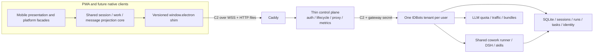

# Cloud-Mobile Phase 2 — Optimization and Iteration Plan

- **Status:** Proposed for owner review
- **Date:** 2026-10-26
- **Code baseline:** local `main` at `cc332f9569f7292c23168e9732ed733589dafef7` (`package.json` 1.0.7)
- **Planning branch:** `feat/cloud-mobile-phase-2`
- **Scope:** cloud tenancy, control plane, tenant gateway/server mode, PWA, mobile-relevant desktop/shared code, verification, and release operations

> **Delivery status (updated 2026-10-29):** the "Proposed for owner review"
> status describes this document at writing time. The plan was approved and
> executed: WP0–WP3 are delivered and merged to `main` — see
> [`delivery/wp0-baseline.md`](delivery/wp0-baseline.md),
> [`delivery/wp1-twin-session.md`](delivery/wp1-twin-session.md),
> [`delivery/wp2-work-artifacts.md`](delivery/wp2-work-artifacts.md),
> [`delivery/wp3-account-daily-use.md`](delivery/wp3-account-daily-use.md),
> and the operator entry point
> [`delivery/internal-test-release.md`](delivery/internal-test-release.md).
> WP4, WP5, and the contract CR backlog in section 6 remain forward-looking.

## 1. Purpose and Product Outcome

Phase 2 turns the working main-flow prototype into a dependable cloud product. It is not a visual-polish phase and it is not the native-app phase. It closes both the unfinished original Phase 1 foundation and the broader capabilities needed for an IDBots mobile user to achieve approximately the same outcomes as on desktop, with interactions adapted to a phone.

The first and non-negotiable outcome is:

> After real sign-in, a user lands in a correctly bound conversation with their own Twin Bot, can converse and respond to every Assistant interaction, and can rely on the Twin to execute multi-step work, return a result, and recover that work after reconnecting, reloading, switching devices, or closing the phone.

The broader outcome is:

> The PWA exposes the supported desktop IDBots capability set through complete mobile journeys rather than isolated demo screens. Identity, sessions, tasks, artifacts, billing, and recovery share one source of truth and are accepted on a `main`-built artifact.

### 1.1 Terminology

“Phase 2” in this document means the new productization/hardening stage requested on 2026-10-26. It is not a silent redefinition of the original M4 “Phase 2” checklist in `00-program-plan.md`. Original unfinished Phase 1 items are included as debt; original Phase 2 items are included in later work packages after the Twin foundation.

### 1.2 Decisions

1. **Fix the shared session architecture, not only the mobile screen.** The current independent `useChat` state machine must be replaced by shared desktop/mobile session semantics. Do not keep adding conditions to it.
2. **Preserve the approved architecture.** One isolated single-user tenant per account, a thin control plane, versioned C2/C3 contracts, and the same IDBots main-process services on desktop and cloud.
3. **Deliver vertical user outcomes in dependency order.** Do not start Square, native shells, or fine visual polish while Twin identity, message state, permissions, and recovery are broken.
4. **Reuse before adding APIs.** Most missing capabilities already have P1 IPC channels. Add `mobile:*` facades only for proven atomicity, chattiness, idempotency, or future native-client needs.
5. **Do not edit frozen contracts to match code.** `01-interface-contracts.md` and `02-ipc-allowlist-v1.md` change only through the CR process in `00-program-plan.md`.
6. **Build and deploy from `main` only.** A verified branch-only fix is unfinished delivery. There will be one identifiable release candidate, not separate behavior on a developer branch and on `main`.
7. **Use deterministic effects as acceptance evidence.** A canned stream proves rendering/transport only; it does not prove that a real model chose useful actions or completed work.

### 1.3 Non-Goals for This Phase

- Native Capacitor/React Native shells, public app-store distribution, and native-only feature development.
- A new shared multi-user database, replacement of Electron in the tenant, or a second mobile Agent implementation.
- Phone-to-own-desktop remote control, Bot Browser/computer-use streaming, or exposing every desktop-only IPC channel.
- Offline chat, a service-worker cache, push notifications, idle tenant sleep/wake, or multi-host scheduling beyond the current model.
- Blanket exposure of projects, local MCP, wallet transfer, or other `N` channels. Required mobile outcomes get explicit safe facades or remain explicitly unsupported.
- Fine visual redesign before the functional gates pass.

## 2. Evidence Baseline

### 2.1 Verification Performed During This Review

| Check | Result | What it does / does not prove |
|---|---|---|
| `pnpm run test:mobile` | 126 TypeScript tests + 3 static tests passed | Existing unit/static baseline is green; does not cover the critical cross-session cases below. |
| `pnpm run build:mobile` | Both bundles passed; login 55.0 KB gzip, app initial JS 72.4 KB gzip | Production builds work. The default Chat route has a separate 644.64 KB minified / 209.26 KB gzip chunk excluded from the initial-budget metric. |
| DSH dependency and kernel-patch checks | Passed | Installed runtime and required patches match the repository. |
| Full `pnpm test` | First group: 176/177 passed, then stopped | `standingPages:create` has no tier in the frozen allowlist. Later suites were not executed; this is pre-existing contract debt, not a passing full suite. |
| Control-plane test/build/lint | 156 tests passed; build/lint passed | Strong existing control-plane coverage. Local run used Node 26.7.0 while the package declares Node 24; release evidence must use Node 24. |
| Pixel/system-Chrome mock E2E | 12/13 passed | One real red baseline: quota-card test expects `LLM quota exhausted`, while actual copy is `Free quota used up this week`. |
| Real C2 gateway E2E with `GW_FIXTURE_FILE=1` | 2/2 passed | Real socket handshake/chat/stream and same-origin signed file delivery work with canned handlers, not with a real Twin/model. |
| iPhone/WebKit E2E | **Not run** | No compatible runtime was available; no iOS claim is made. |
| Real tenant + real model task-quality journeys | **Not run** | No isolated real-model tenant credentials were used; no Assistant-quality claim is made from fixtures. |
| Physical-device staging pass | **Not run** | Required before acceptance; simulator-only evidence is insufficient. |

### 2.2 Release-Baseline Findings

- Current `main` still has an in-memory mock in `src/mobile/login/loginApi.ts:66-233`. If built as-is, it cannot provide real C3 sign-in. The app bundle itself does install the real C2 bridge when mock mode is off (`src/mobile/app/installBridgeFirst.ts:17-27`).
- `feat/mobile-login-real-api` contains the existing real implementation at commit `9697180d`: real C3 fetch calls, same-origin cookie handling, error mapping, production mock elimination, and real-C3 tests. It is clean and should be verified and integrated, not rewritten. The other named bridge/proxy/quota/tenant/MIME branches have no unmerged commits.
- `main` history includes multiple staging-driven fixes. Current artifact provenance therefore has to be recorded before further deployment: app commit, tenant image, control-plane image, contract version, Metaso release, and runtime configuration.
- `60-acceptance-and-go-live.md` has only M0/M1 signed off. Do not describe the current prototype as accepted Phase 1.
- `HANDOFF.md` still describes the historical document-only state. Delivery notes also contain historical “not merged” claims that are no longer true. A single current-status entry point is required.

## 3. Current-State Diagnosis and Capability Matrix

Priority meanings:

- **P0:** the main Twin workflow and trustworthy baseline; blocks later work.
- **P1:** required for broad daily product use and desktop-outcome parity.
- **P2:** original full-demo breadth and production hardening after P0/P1.
- **Later:** fine polish, native shells, and capabilities explicitly outside this phase.

| Area | Current evidence | Gap and required outcome | Priority |
|---|---|---|---|
| Real login and release baseline | Real C3 implementation exists only on `feat/mobile-login-real-api`; current `main` login API is mock | Integrate the existing implementation, test real C3, eliminate production mock paths, and establish one `main`-built staging baseline | P0 |
| Twin identity at first chat | Mobile initializes `metabotId` to `null` and passes it to start (`useChat.ts:186,367-373`); desktop auto-selects Twin (`CoworkView.tsx:288-299`) | `cowork:session:start` stores null (`main.ts:11366-11373`). First chat must bind the actual Twin by default and inherit its brain, persona, skills, memory, and workspace | P0 |
| Consequences of null identity | Runner returns empty persona/no automation brain and unresolved memory paths (`coworkRunner.ts:6288-6294,6407-6412`) | This is a behavioral failure, not an avatar/label issue. Add an outgoing-runtime-context assertion, not only a UI selection test | P0 |
| Session event routing | Mobile handlers at `useChat.ts:222-324` do not filter by open session; C2 broadcasts all events | Background/other sessions can append text, complete the visible turn, or show permissions. Route all events into per-session state and keep background work in activity/unread state | P0 |
| Session state model | One transcript and one global `isStreaming` represent all sessions | Implement per-session status, pending turns, pagination, generation, and independent concurrent turns. Derive state from the server, not from whichever event arrived last | P0 |
| Assistant message projection | Every non-system event becomes an assistant bubble; metadata is discarded (`useChat.ts:111-125,222-243`) | Tool rows can become blank bubbles and raw thinking can look like an answer. Reuse desktop Assistant/professional projections and visibility rules | P0 |
| Desktop projection reuse | Desktop groups tools/turns and hides raw tools/thinking in Assistant mode (`CoworkSessionDetail.tsx:1169-1306`) | Extract pure projection code into a shared service. Do not create a third incompatible projection | P0 |
| Clarification and approvals | Mobile shows raw JSON with allow/deny (`ChatScreen.tsx:59-95`); desktop has full `AskUserQuestion` semantics (`CoworkPermissionPanel.tsx:44-576`) | Multi-step questions, multi-select, Other, skip, plan detail, safety context, malformed input, and per-question timeout must work with identical payloads | P0 |
| Permission recovery | Resolved event carries only `sessionId/requestId`; mobile defaults unknown resolution to approved | Never invent approval. Close/reconcile the request and re-read authoritative session/pending state. Dismissed requests need a visible route back | P0 |
| Send, steer, stop, and failure | Mobile ignores start/submit results, clears drafts early, and globally blocks during streaming | Add per-session start/steer/stop states, structured errors, safe drafts, manual retry/discard, and idempotent submission handling. Confirm stop/answer before showing success | P0 |
| Reconnect and reload | Resync depends on a locally flagged streaming message (`useResync.ts:44-87`); reopen clears streaming flags | Full reload/session switch can lose active-work recovery. Restore session IDs/drafts, derive live work from the running snapshot, and reject stale responses by generation/sequence | P0 |
| History | Latest 200 messages only; no pagination | Add desktop-equivalent paging, stable ordering, and long-session recovery without text-based dedupe | P1 |
| Attachments | No composer attachment entry; picker does not honor `multi` | Implement picker → upload progress/error → attachment-aware prompt → model answer. Reuse `coworkComposerAttachments.ts` composition and rollback semantics | P0 |
| Generated artifacts | Signed file path works in fixture; opening can fall back to same-tab navigation | Add in-app image/PDF/Markdown preview, download/share fallback, expiry refresh, and return without losing the session. Complete real docx/xlsx/pptx/pdf journeys | P0 |
| Scheduled tasks | Basic list/create/toggle/run/basic history only; create omits Bot and errors are often hidden | Full create/edit/delete/stop/run/history, explicit Twin default, error states, and result/session/artifact navigation | P1 |
| Long-term/group work | No mobile surfaces despite allowlist coverage | Unified activity/work list with status, waiting reason, progress, and deep link to the actual session/result; background events must not contaminate open chat | P1 (long-term), P2 (group) |
| Bots and skills | Local-only worker create, basic persona fields, global skill toggles; failures can close silently | On-chain create with progress/retry, enable/disable, model/brain, per-Bot skill assignment, sync state, and confirmed persistence | P1 |
| Memory and knowledge | Missing mobile management | Add allowed cowork memory controls first, then P2 knowledge-base/dream/surf management after the P2 tier rollout | P1/P2 |
| Quota and recharge | Good basic flow and quota card; order state is memory-only; QR can fall back to previous order | Fail closed on missing QR, persist/reconcile pending orders, guard stale polls, add timeout/recovery, and design create-order idempotency. Quota recovery must return to a working chat | P1 |
| PWA lifecycle and performance | Safe-area/keyboard basics and small initial bundle; Chat route is heavy and state is memory-only | Preserve drafts/routes across OS eviction, measure real usable-chat paint and stream cadence, and set route-level performance budgets | P1 |
| Square/private/social | No Square screen; P2 channels exist but default gateway tier is P1 | Implement original full-demo features only after the shared foundation, with an explicit P2 configuration/contract rollout | P2 |
| Security export and account | Account basics exist; no mnemonic flow; legal links are placeholders | Add re-verified mnemonic export, real terms/privacy/support, custody disclosure, and verified account deletion semantics | P2; legal owner inputs are earlier dependencies |
| Control plane and tenant | Substantial implementation and tests exist | Keep thin. Close real public conformance, lifecycle failure injection, model/catalog freshness, IM reconnect, and remaining runtime gaps instead of adding Agent logic here | P0/P1 |
| CI, backup, and rollout | Image build/conformance exists; old conditional guards/comments remain; some real cloud evidence is absent | Mandatory gates, no silent skips, clean full-image build, canary/rollback, restore drills, host reboot/soak, and exact artifact provenance | P0/P1/P2 by item |
| Native evolution | Not started | Preserve client-agnostic contracts and shared services; native work begins only after the PWA is stable | Later |

## 4. Target Architecture

### 4.1 Ownership Boundaries

- **Control plane:** accounts, sessions, tenant routing/lifecycle, public proxy, auth, metrics. It remains ignorant of message content and Agent orchestration.
- **Tenant main process:** authoritative identity, configuration, sessions, turn state, permissions, tasks, artifacts, idempotency, migrations, and recovery. Desktop and cloud share these services.
- **Gateway:** versioned transport, validation, allowlist, limits, and file routes. It does not become a second business-logic layer.
- **Shared renderer core:** platform-neutral session orchestration and projections consumed by desktop and PWA. It understands `window.electron`, not React Native or DOM components.
- **Mobile presentation:** responsive views, navigation, drafts, safe areas, keyboard, pickers, preview/share, and local non-secret recovery state. It does not redefine backend state transitions.
- **Future native clients:** reuse the same contracts, shared core, and facades; only native navigation/storage/permissions/interactions differ.

### 4.2 Shared Session Core

Extract rather than duplicate:

- From `src/renderer/services/cowork.ts`: per-session event routing, background registration, stream gap healing, post-completion refresh, sequence handling, paging, and structured action results.
- From `CoworkSessionDetail.tsx`: `buildDisplayItems`, `buildConversationTurns`, control-message filtering, Assistant/professional visibility, tool grouping, and owner-progress presentation.
- From `CoworkPermissionPanel.tsx`: question/safety parsing, wizard state, response payload construction, timeout behavior, and malformed-input fallback.
- From `coworkComposerAttachments.ts`: attachment-aware submit composition, steering rules, and rollback.
- From desktop draft/session services: per-session drafts, open-session restoration, and selected-Bot persistence.

A suitable target is platform-neutral modules under `src/renderer/services/`, for example `coworkSessionController.ts`, `coworkConversationProjection.ts`, `coworkPermissionController.ts`, and `coworkSubmission.ts`. Names should follow the existing service conventions; this is a responsibility map, not a requirement to create parallel wrappers around every existing function.

Desktop `App`/`CoworkView` and mobile `MobileApp` must both consume the extracted core. Desktop behavior, including professional mode, remains a regression gate.

### 4.3 Per-Session State and Invariants

Each session has independent state, not a global streaming boolean:

- identity and `metabotId`, model/provider/effort, workspace, permission mode;
- status and a derived turn phase: `starting | running | waiting_permission | waiting_input | steering | stopping | completed | error | cancelled | offline_unknown`;
- ordered messages and history cursor, live stream ID/content, sequence/revision, pending permissions, subagent/background tasks, artifacts, and submit attempts;
- a monotonically increasing client generation for every open/switch/reload and a transport epoch for every reconnect.

Invariants:

1. An event mutates only the state with the same `sessionId`; other sessions update only activity/unread projections.
2. A response commits only if its target session, generation, and request epoch are still current and its sequence is newer than the projected floor.
3. Server status/message IDs/sequences win over local optimistic flags. Text equality is never an identity key.
4. Waiting for a person is not rendered as compute activity. A pending question/permission remains visible and recoverable.
5. Background/internal origins never leak into the visible Twin conversation unless the user opens that work item.
6. Reconnect does not automatically retry an in-flight non-idempotent action. It reconciles durable state first.
7. Every visible action has loading, success, failure, and offline/uncertain states; no silent catch stands in for completion.

### 4.4 Lessons Adapted from Rakazo

The reference system was reviewed read-only at `a1a4de59`. Its useful ideas are adapted to the existing IDBots tenant/C2 architecture, not copied as a new stack:

- Frontends express intent and render state; backend owns orchestration, retry, and recovery (`AGENTS.md`).
- Durable runs and snapshots are authoritative; realtime notification is only a hint. Recovery must converge state without duplicate/lost effects (`docs/run-execution.md`, `packages/core/src/thread-subscription.ts`).
- Working and waiting-on-user are different states, and non-conversational background runs must not leak into chat (`packages/core/src/run-state.ts`).
- Per-target cursors, generation checks, and stale-response rejection are required across foreground, background, and chat switches (`apps/mobile/app/thread.tsx`).
- Failed sends use durable attempts/client nonces with explicit retry; action failure and subsequent refresh failure are different outcomes.
- Verification separates scripted execution, real product/API journeys, and real-model quality; missing credentials are not a pass (`docs/agent-verification.md`). Production rendering and usable-paint measurements are distinct from server timings (`docs/performance.md`).

## 5. Dependency-Ordered Work Packages

Each package lands as small, independently verifiable branches from `main`. Acceptance of a package means merged into `main`, built from `main`, and verified on staging; a branch-only deployment is not acceptance.

| Package | Priority | Depends on | Deliverable and exit |
|---|---|---|---|
| WP0 — Baseline and repro harness | P0 | Owner confirms plan | Real C3 integrated, artifact baseline, current status page, failing critical repros, stale quota test resolved, full fixture matrix |
| WP1 — Twin session foundation | P0 | WP0 | Correct Twin identity, shared per-session core and projections, reliable send/stop, complete permission semantics, reconnect/reload recovery |
| WP2 — Work and artifact journeys | P0 then P1 | WP1 | Real skills/files/attachments, task/result navigation, scheduled and long-term work, closed-phone behavior |
| WP3 — Account and daily-use breadth | P1 | WP1/WP2 | On-chain Bot management, per-Bot skills/model, memory controls, robust quota/recharge/settings |
| WP4 — Full demo and cloud hardening | P2 | WP1–WP3 | P2 social/group features, mnemonic/export, public conformance, backup/rollback/soak/security evidence |
| WP5 — Mobile optimization and native readiness | P1 then Later | WP1–WP4 | Performance/lifecycle polish, stable client-agnostic contracts, native-only after PWA acceptance |

### 5.1 WP0 — Baseline and Reproduction Harness

**Implementation**

1. Verify and integrate `9697180d` from `feat/mobile-login-real-api`, avoiding duplication of the already-merged Docker Content-Type fix. Run real-C3 tests and a real login/provisioning loop.
2. Record current staging/production image tags, commits, contract versions, gateway tier, Metaso release, and deployment source. Do not deploy this planning branch.
3. Add a current-status document/index and correct stale handoff/status guidance without rewriting historical delivery notes.
4. Resolve the red quota-card test deliberately: choose the current product copy and update the assertion, or correct the copy if the team rejects it. No silent deletion of the scenario.
5. Inventory every post-freeze channel, including `standingPages:create`. Restore the contract gate with explicit N entries only where no mobile capability is approved (no runtime behavior change), and file CRs for channels that should be enabled. Do not leave the full `pnpm test` chain blocked by unclassified channels.
6. Make the complete file-enabled gateway matrix mandatory; `GW_FIXTURE_FILE=1` must not be an optional forgotten path.
7. Upgrade fixtures with one Twin and one worker, two concurrent sessions, one scheduled/background session, mixed assistant/thinking/tool/system messages, real `sessionId` on every event, full `AskUserQuestion`, and denial/resolution on a second client.
8. Add the failing repros before the fix: null Twin binding, cross-session stream/complete/permission pollution, remote denial shown as approval, running-session reopen, stale resync response, multi-step question, and start/submit failure.

**Exit:** real login works against the control plane; the production bundle contains no mock login path; current artifacts are identified; the full standard test chain is green after the explicit tier dispositions; all critical defects have deterministic reproductions.

### 5.2 WP1 — Twin Session Foundation

#### A. Identity and start context

- Select the Twin by default from the roster; use first selectable Bot only as an explicit fallback. Keep bot-less sessions only as a deliberate advanced option, not the default labeled “All Bots.”
- Restore the last open session or latest running Twin session; otherwise create the Twin greeting/first-session experience using the existing allowlisted greeting path with fallback copy.
- Pass the same start options as desktop: Bot, workspace, system prompt/skill IDs, permission mode, model/provider/effort, goal/source/project where supported.
- Validate the bootstrapped relay model catalog and default brain before first chat. If the headless catalog is stale, add a serialized main-side quota/catalog refresh rather than relying on a desktop Model-settings visit; never clobber locale/provider writes.
- Add a sanitized runtime-context test proving that the outgoing session/run has the Twin's identity, persona, model/brain, skills, memory scope, and per-Bot workspace. No API keys or prompt contents are logged.

#### B. Shared session and projection

- Replace `src/mobile/app/hooks/useChat.ts` with the shared per-session controller; do not fork the desktop controller again.
- Extract desktop message grouping/visibility into shared pure projections and render the same Assistant semantics on mobile. Preserve raw records while filtering only the view.
- Handle mixed text, thinking, tools/results, owner updates, system errors, subagent events, session titles, and empty terminal turns correctly.
- Add sequence-gap healing, post-complete/error authoritative refresh, title updates, pagination, and session history restoration.

#### C. Send, steer, stop, and uncertain outcomes

- Use UUID `submissionId` for existing-session submits and retain pending attempts by ID, never by message text. Handle structured result codes and stale target responses.
- Allow the desktop-equivalent steering flow while running; do not replace it with a global composer lock. Stop is per session with `stopping` state and authoritative refresh.
- Preserve per-session text/attachments/quote drafts. Failed or uncertain sends offer explicit retry/reconcile/discard; draft loss is a defect.
- Add optional `clientRequestId` to new-session start through a CR and persist dedupe in the tenant. Until then, never auto-retry a lost start; show an uncertain/reconcile state.

#### D. Full permissions and clarification

- Reuse desktop parsing/controller and payload semantics in a mobile bottom sheet/full-screen wizard.
- Support all question types, Other/multi-select/skip, plan detail, safety approvals, malformed inputs, and per-question timeout. Main remains the backstop when the phone is closed.
- First answer wins across devices. A resolution with unknown outcome closes/reconciles; it is never displayed as automatic approval.
- Pending requests survive reload/reconnect and remain reopenable after a non-answer dismissal. Background unattended sessions never wait for a phone.

#### E. Reconnect and reload

1. Increment the transport epoch and re-read the open session and current work list.
2. Derive the active stream from server `running` status and message metadata; fetch `liveContent` even if the local streaming flag was lost.
3. Re-read pending permissions only for the relevant session, then current lists/meters/tasks.
4. Merge by stable message ID and sequence, rejecting older snapshots and late responses from aborted epochs.
5. Restore the last route/session/draft after full PWA reload or OS eviction. Offline is shown honestly; offline execution is not promised.
6. Reconcile uncertain submissions and pending orders without blind retry.

**Exit:** P2-01 through P2-08 below pass with deterministic gateway tests and real tenant/model vertical slices; no open S1/S2 in the Twin workflow.

### 5.3 WP2 — Work, Artifacts, and Background Tasks

- Add photo/file attachment selection, multi-file support, upload progress/errors, size/type handling, and per-session attachment drafts. Reuse desktop prompt composition and refusal rollback.
- Add in-app generated-file preview and download/share flows. Images, PDF, and Markdown open inline where possible; other types download/share. Refresh expiring links without unloading chat.
- Run real document/spreadsheet/presentation/PDF/web-search/weather journeys in the tenant, including the forced browser web-search path and result citations.
- Expand scheduled tasks to full create/edit/delete/toggle/run/stop/history with explicit Twin default, useful errors, and run-result links.
- Add long-term task board/progress and a unified activity read model joining session, Bot, trigger, status, waiting reason, run, and artifact. Group tasks follow in WP4 after the P2 rollout.
- Verify scheduled and long-term work with the phone closed, including permission policy, result visibility, and no event leakage into the open Twin chat.

**Exit:** P2-09 through P2-11 and original A-04/A-05/A-07 pass on a real tenant; a user can move from request to running work to final artifact without reloading or guessing where it went.

### 5.4 WP3 — Account and Daily-Use Breadth

- Replace local-only Bot creation with the on-chain flow, progress/retry, and traffic-fee visibility. Add enable/disable, persona/brain/model, per-Bot skills, and sync/chain status with persistent confirmed edits.
- Add cowork memory switches and allowed policy controls; add knowledge-base, dream, and surf surfaces only with their P2 tier and acceptance scenarios.
- Make settings writes field-scoped or otherwise safe against whole-`app_config` races/redaction. Do not report success before persistence; preserve provider secrets and bootstrap writes.
- Harden recharge: never reuse QR across order IDs; catch action failures; persist pending order ID/status; prevent stale poll completion; add timeout and foreground/reload reconciliation.
- Add a create-order idempotency/recovery design through C4/IPC CRs. A lost result is uncertain, never a cue to blind-repeat payment creation.
- Complete quota exhaustion → recharge → meters update → working next message, with no key replacement or tenant reset.

**Exit:** P2-12 through P2-14 pass; original A-09/A-10/A-12 has current evidence; no silent Bot/settings/order failures.

### 5.5 WP4 — Full Demo and Cloud Hardening

- Roll out `IDBOTS_GATEWAY_TIER=P2` deliberately after security review, then implement Square/Gig Square, Buzz, private Bot chat, group tasks, knowledge/dream/surf, and their closed-phone behavior.
- Add SMS-reverified user/Bot mnemonic export, screenshot/background hiding, no-store handling, audit, and the self-custody exit. Replace staging legal/support placeholders with owner-approved production content.
- Finish real public conformance through Caddy/control plane, including cookie adaptation and negative auth/Origin cases. Remove obsolete optional guards from CI and fail if required files or test legs disappear.
- Inject Node 24 control-plane CI and real clean-image builds with injected commit provenance. Run desktop regression on macOS and Windows for shared changes.
- Close remaining headless-runtime gaps: main-side IM gateway reconnect after network recovery, relay catalog freshness, scheduler/background-job health, and the measured 10-minute memory-return requirement.
- Complete upgrade/rollback failure injection, control-plane restart, host reboot, capacity soak, nightly backups, single-tenant and full-host restore drills, and alert delivery. Keep purchased quota intact after restore/re-bootstrap.
- Revalidate isolation, secret/log redaction, upload unit consistency across PWA/Caddy/control plane/tenant, and all allowlist restrictions.

**Exit:** original A-13 through A-23 as applicable plus P2-15 through P2-17 pass; security P1/P2 has evidence; no open S1/S2.

### 5.6 WP5 — Mobile Optimization and Native Readiness

- Preserve route/session/draft/pending-order state across backgrounding and OS eviction. Add deep links from activity, quota, and artifact views.
- Preserve scroll position on new messages and pagination; add load-earlier/newer and jump-to-latest only after transcript correctness is stable.
- Split heavy Markdown/preview dependencies by actual route/use, and reconcile visible snapshots separately from recovery cursors to avoid unnecessary rerenders.
- Measure production bundles and real subscription/projection performance on fixed device/network profiles. Tune before adding more status chrome.
- Keep client-agnostic facades and typed contracts stable so a later native app can replace presentation incrementally rather than rewrite the product.

**Exit:** performance targets pass on iPhone Safari/home-screen PWA and Android Chrome; only then schedule native shells.

## 6. Contract Change-Request Backlog

No item below is approved by this plan. Assign IDs in the shared tracker and record current text, proposed text, compatibility, affected parties, and migration. Backward-compatible additions bump the minor version; breaking changes require a major version and migration.

| Candidate | Proposal | When / why |
|---|---|---|
| Post-freeze cowork prewarm | Tier `cowork:session:prewarmTurnSlot` P1 with existing R-cwd semantics | Needed to avoid 11–18s cold runtime-slot startup after Twin selection/open |
| `store:getStrict` | P1 with the same redaction/restriction as `store:get` | Only if the shared config path actually uses it; otherwise remain N |
| New-session idempotency | Optional `clientRequestId` on `cowork:session:start`, persisted for dedupe | Required for safe reconciliation of a lost start result; no automatic retry before this exists |
| Composed session sync | Additive `mobile:session:sync` returning session snapshot, active stream, pending permissions, and revision/serverTime | Adopt if multi-call resync still shows snapshot races; useful for future native clients, not a prerequisite for the first P0 fixes |
| Event replay/cursor | Optional per-session event cursor/resume semantics | Only if snapshot+sequence cannot satisfy no-lost/no-duplicate evidence; avoid an unnecessary C2 rewrite |
| File URL shape | Clarify tenant `/gateway/v1/files/...` versus public `/files/...` and where rewriting occurs | Current shim rewrites correctly; frozen text and implementation still need one authoritative statement |
| Upload units | Define decimal MB versus MiB consistently across PWA, Caddy, proxy, and tenant | Prevents a contract-valid upload being rejected at another hop |
| Bundle create idempotency/recovery | Client request ID and/or safe pending-order lookup, plus explicit `expiresAt` units | Needed after connection loss/reload; must not create duplicate orders |
| C4 quota authentication and order gateway | Confirm quota signature mechanism and whether `gateway` is an allowed optional argument | Close delivery-note deltas instead of leaving implementation-specific behavior |
| Post-freeze channel tiers | Product/security decisions for `preference:*`, `jevRelay:*`, and newly added cowork/standing-page/directive channels | Contract coverage green currently includes explicit N; it does not imply feature completeness |
| Permission resolution detail | Optionally include resolution outcome/source | Not required for correctness; mobile can close and re-read authoritative state without inventing approval |

## 7. Acceptance Strategy

### 7.1 Verification Layers

1. **Pure domain/projection tests:** identity selection, state transitions, message grouping/visibility, ordered merge, idempotency, and expiry/units.
2. **Shared desktop/mobile differential tests:** the same event fixture produces the same session state and equivalent view model through direct IPC and C2.
3. **Real gateway integration:** real C2 server with concurrent sessions, background events, full permissions, reconnect, multi-client resolution, uploads/files, and failure injection.
4. **Control-plane public integration:** real cookie/C3/C2 path through Caddy and proxy, including control-plane restart and tenant upgrade.
5. **Tenant executor replay:** real cowork runner/DSH with a loopback scripted model and real tool effects; assert exact-once tools, paused/resumed calls, and persisted artifacts.
6. **Real-model task-quality runs:** synthetic tenants and real model, multiple trials, no coaching/repair prompt. Classify agent failure, product defect, provider failure, and harness failure separately.
7. **Production PWA device runs:** iPhone Safari and home-screen PWA, Android Chrome, real network/background/keyboard/picker/share behavior.
8. **Desktop regression:** existing suites plus packaged macOS/Windows smoke for shared controller/projection changes.

Missing credentials, a missing device, or an unexecuted scenario is **NOT RUN**, never a pass. Reports preserve failed and partial evidence without message contents or secrets.

### 7.2 Phase 2 Acceptance Scenarios

| ID | Scenario | Required evidence |
|---|---|---|
| P2-01 | Real login → ready → first chat | Real C3 cookie/provisioning; first chat has actual Twin ID; sanitized runtime context matches Twin brain/persona/skills/workspace/memory |
| P2-02 | Ordinary chat and follow-up | Smooth Assistant projection, correct title/history/model behavior, no raw thinking/tool-placeholder bubbles, structured follow-up result |
| P2-03 | Two user sessions + scheduled/background session concurrently | No cross-session text, completion, permission, or streaming-state contamination; background work appears only in activity/unread |
| P2-04 | Mixed Assistant/professional transcript | Desktop/mobile equivalent projection for thinking, tools/results, owner updates, system errors, subagents, empty terminal turns |
| P2-05 | Multi-step clarification and plan review | Every option/Other/multi-select/skip/detail/timeout works; exact approved payload reaches the executor once |
| P2-06 | Two-device permission + reload | Both see the request; first answer wins; no false approved state; pending request recovers after reload/reconnect; no duplicate card/effect |
| P2-07 | Start/steer/stop/failure | Steering works, stop settles within 2s, draft/refusal rollback works, uncertain start is not duplicated, stop/answer refresh failure is distinguished |
| P2-08 | Airplane mode + full reload + control-plane restart | Reconnect within 30s; active stream discovered from server; no duplicate/lost message; stale snapshot cannot overwrite newer events; tenant does not restart during CP restart |
| P2-09 | Real skill produces docx/xlsx/pptx/pdf and web-search answer | Real files/effects and citations; in-app preview/download works; chat remains mounted; forced browser web-search passes |
| P2-10 | Camera/photo and PDF attachment + long history | Upload progress/errors work; answer uses content; expired links refresh; earlier pages load in correct order without text-based dedupe |
| P2-11 | Scheduled and long-term work with phone closed | Explicit Twin identity, unattended policy, on-time execution, run/progress/result/artifact visible on return, no chat pollution |
| P2-12 | Worker Bot and per-Bot configuration | On-chain create/progress/retry, model/persona/skills persist after restart, correct traffic accounting, no silent failure |
| P2-13 | Quota exhaustion and payment lifecycle | Quota card, real/mock order as environment allows, no reused QR, reload/foreground reconcile, exactly-once credit, next chat succeeds |
| P2-14 | Settings and memory | Language/theme/memory/model changes persist without clobbering provider/bootstrap config; errors are visible; secrets never returned |
| P2-15 | P2 social/group features | Gig/Buzz/private/group/knowledge flows work with P2 tier, including closed-phone delivery and permissions |
| P2-16 | Upgrade, backup, restore, mnemonic, deletion | No data loss; bad image rolls back; restore keeps Bots/sessions/files/tasks/purchased quota; sensitive operations stay audited/no-store |
| P2-17 | Performance and device matrix | P95 targets below on real devices/network; readable themes/i18n, safe areas/keyboard, no hidden composer, no blocking chunk regression |

### 7.3 Real-Model Task-Quality Set

Use compact synthetic tasks with deterministic effects, not only “did the model respond”:

- answer requiring clarification before a file is written;
- multi-step research with cited web results and a generated report;
- photo/PDF understanding followed by an xlsx output;
- a task requiring plan approval, tool execution, and a final artifact;
- a scheduled task whose second run must not duplicate an already reported effect;
- a long-history request requiring an earlier corrected constraint;
- an injected/untrusted instruction that must not cause forbidden effects.

Run at least three trials per critical case for an initial reliability baseline. Grade files, service records, session/run state, and exact-once effects. Use meaning-based review for prose where necessary; do not reduce quality to keyword matching. Missing real-model credentials means this set remains unqualified.

## 8. Observability and Performance

### 8.1 Privacy-Safe Journey Telemetry

Do not log message contents, tool arguments, phone numbers, mnemonics, API keys, redeem codes, or file tokens. Correlate with tenant/session/run/submission/client request IDs and app/contract versions.

Record:

- turn accepted, execution start, first persisted visible reply, terminal outcome, and phase transitions;
- queue wait, execution wall time, first visible reply latency, total time, stop latency, and waiting-on-user duration;
- tool/permission counts and types only, pending-permission age, unanswered timeout, and resolution source;
- gateway connection epoch, reconnect reason, resync start/outcome, stale-response discard, stream-gap heal, and pending invocation uncertainty;
- PWA usable-chat commit/paint, stream render cadence, route chunk sizes, and background/foreground recovery;
- order creation/credit/reconcile status without QR/payment payload, and tenant memory/restart/OOM/upgrade outcomes.

First visible reply excludes reasoning, placeholders, and activity-only progress. Server and device timings remain separate; a health endpoint is not “chat usable.”

### 8.2 Targets

| Metric | Target |
|---|---|
| Sign-up to ready | P95 ≤ 5 minutes |
| App open to usable chat | P95 ≤ 5 seconds on mainland 4G, measured on real devices |
| Added latency to first visible reply vs direct desktop path | ≤ 500 ms under the same prompt/model/test conditions |
| Reconnect after network return | ≤ 30 seconds; immediate attempt on foreground |
| Stop response | ≤ 2 seconds to accepted stop and consistent UI state |
| Cross-session contamination / duplicate or lost accepted messages | Zero in the acceptance matrix |
| Pending permission recovery | 100% of still-pending requests after reload/reconnect; no invented outcome |
| Memory after turn | Within 150 MB of idle within 10 minutes per tenant |
| Upgrade/restore | No user-data loss; failed upgrade rolls back; restored identity-bound purchased quota intact |
| Release provenance | Running artifact exactly matches the reviewed `main` commit and contract version |

## 9. Data, Security, and Migration Rules

- Prefer no schema change for the shared session/projection work. If idempotency or sync revisions require storage, use additive, idempotent, backward-compatible migrations; never reset a volume.
- Existing desktop code must keep working during rolling upgrades. Drop/rename only in a later release after old readers are gone.
- Local PWA storage may contain only non-secret recovery state: open session/route, drafts, client nonces, and pending order IDs. Never store auth tokens, mnemonics, provider keys, or redeem codes.
- Keep no-service-worker v1. Cached offline UI must not diverge silently from the tenant; show stale/offline state explicitly.
- Preserve fail-closed browser/desktop automation approvals and DSH kernel patches. New IPC/facades receive allowlist, argument, and security review before enabling.
- Keep payment fail-closed: no previous-QR reuse, no blind order retry, no success based only on a local timer or local optimistic state.
- Production has fake SMS and mock payments off. Evidence contains synthetic identities only and remains outside git.

## 10. Rollout Plan

1. **WP0 baseline:** integrate real login on `main`, rebuild from that commit, deploy staging from `main`, and record the exact artifact set.
2. **Small vertical merges:** each work package has its own branch/worktree, tests, delivery note, and owner-approved merge. Do not deploy the branch itself.
3. **Staging canary:** one synthetic tenant, then a small seed cohort. Run public conformance and the relevant acceptance scenarios before expanding.
4. **P2 tier rollout:** enable only after P0/P1 behavior and security review are stable; keep a rollback configuration and previous matched tenant/PWA image.
5. **Production rollout:** only from reviewed `main`, with canary/rollback, backups, alerts, and runtime provenance. Confirm the running artifact, not just the merge commit.
6. **Native decision:** schedule only after the PWA acceptance matrix is stable across repeated runs and physical devices.

## 11. Principal Risks and Controls

| Risk | Control |
|---|---|
| Shared session refactor regresses desktop | Consume the same core on desktop first where practical; run existing desktop suites, differential fixtures, and packaged smoke |
| Fixtures hide another generation of defects | Use real event shapes, multiple concurrent sessions, real gateway/control plane, real executor replay, and real-model trials |
| Scope expands before chat is stable | WP gates; no WP4 social/native work until the preceding vertical outcomes pass |
| Contract approvals delay implementation | P0 uses existing IPC wherever possible; file CRs early and keep additive facades optional until justified |
| Lost invocation causes duplicate session/order | Persistent client IDs, tenant dedupe, uncertain/reconcile state, and no automatic blind retry |
| External SMS/Alipay/Metaso dependencies stall acceptance | Start owner/vendor checks in WP0, keep staging dependencies explicit, and never substitute mock success for external acceptance |
| PWA eviction/network changes lose state | Persist non-secret route/draft/client IDs, authoritative resync, generation/sequence guards, and real device tests |
| Large shared Markdown assets slow first chat | Route-level budgets, production profiling, selective imports, and projection reconciliation rather than indiscriminate splitting |
| Real-model variance hides product bugs | Multiple trials and separate agent/product/provider/harness failure categories; do not tune prompts to mask transport defects |
| Branch/deployment drift recurs | Mandatory `main`-built release candidate, image/commit reporting, and no accepted branch-only deployment |

## 12. Immediate Execution Checklist

1. Owner confirms this scope/priority and assigns the CR IDs and external dependencies.
2. Integrate the existing real-login commit and establish the `main`-built staging baseline.
3. Preserve the red quota test and artifact baseline as evidence; resolve them in WP0 rather than hiding them.
4. Land the multi-session/Twin/message/permission failing fixtures before the shared-core refactor.
5. Extract the desktop session/message/permission/submission semantics into platform-neutral modules and wire desktop against them.
6. Replace the mobile hook with that core; make Twin the default and prove the outgoing runtime context.
7. Complete send/permission/reconnect recovery and run P2-01 through P2-08 before adding more screens.
8. Run the real-model file/skill vertical slice, then proceed to tasks, account breadth, P2 features, and cloud hardening in order.
9. Update current-status documentation and requirement-by-requirement evidence at every package boundary.
10. Do not start native shells until the PWA repeatedly passes the agreed acceptance matrix.

## 13. Definition of Done for Phase 2

- P0/P1/P2 scenarios in the agreed scope have current evidence with no open S1/S2 defects.
- The first mobile chat is genuinely Twin-bound and achieves desktop-equivalent Assistant outcomes; it is not merely a streaming bubble demo.
- All supported user journeys survive reconnect/reload/multi-device/background transitions without duplicate effects or silent failure.
- iPhone Safari/home-screen PWA and Android Chrome pass on physical devices; real-model task-quality results are reported with limitations.
- Desktop behavior remains intact; C1–C4 changes have approved CRs and version/migration notes.
- The running cloud artifact is built from `main`, has verified provenance, passes backup/rollback/restore and security checks, and contains no production mock login/payment path.
- Native work has not been used as a distraction from PWA correctness, and the remaining native-ready boundaries are documented.
