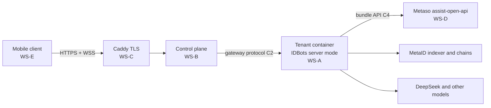

# IDBots Cloud and Mobile — Handoff Package

This folder turns the approved design
([`docs/superpowers/specs/2026-10-14-mobile-cloud-design.md`](../superpowers/specs/2026-10-14-mobile-cloud-design.md))
into documents that can be handed to separate development parties, an operations
agent, and the Metaso team. Each party gets the shared documents plus its own
workstream document, builds against the frozen interface contracts, and is
accepted against the criteria written here.

## What Is Being Built

A user downloads the IDBots app (Android APK, iPhone TestFlight, or the web
app), signs up with an invite code and a phone number, and gets a personal
cloud computer that runs the IDBots backend around the clock. The phone is a
thin client over a WebSocket gateway. One Alipay order buys a bundle that
covers both LLM usage and on-chain traffic. The first release is invite-only,
for users mainly in mainland China, hosted in Alibaba Cloud Hong Kong.

## Documents and Who Gets Them

| Document | Content | Give to |
|----------|---------|---------|
| [`00-program-plan.md`](00-program-plan.md) | Workstreams, dependencies, milestones, environments, procurement, change control, risks, owner decisions | Everyone |
| [`01-interface-contracts.md`](01-interface-contracts.md) | C1 tenant runtime, C2 gateway protocol, C3 control-plane public API, C4 Metaso bundle API | Everyone |
| [`02-ipc-allowlist-v1.md`](02-ipc-allowlist-v1.md) | Which IPC channels and events the phone may use (mobile API v1) | WS-A, WS-E, acceptance |
| [`10-ws-a-idbots-server-mode.md`](10-ws-a-idbots-server-mode.md) | IDBots server mode, IPC registry, gateway, tenant image | IDBots development party |
| [`20-ws-b-control-plane.md`](20-ws-b-control-plane.md) | Invites, SMS login, provisioning, proxy, admin CLI | Control-plane development party |
| [`30-ws-c-infra-ops.md`](30-ws-c-infra-ops.md) | Hosts, network isolation, TLS, registry, CI, backups, monitoring, runbooks | Operations agent |
| [`40-ws-d-metaso-bundle.md`](40-ws-d-metaso-bundle.md) | Bundle product, identity-bound LLM quota, partner IP policy | Metaso team |
| [`50-ws-e-mobile-client.md`](50-ws-e-mobile-client.md) | Mobile web app, `window.electron` shim, Capacitor shells | Mobile development party |
| [`60-acceptance-and-go-live.md`](60-acceptance-and-go-live.md) | End-to-end scenarios, non-functional targets, security and go-live checklists, sign-off | Owner, acceptance reviewer, every party |

Phase 0 (the Linux headless spike that must pass before any of the above
starts) has its own executable plan:
[`docs/superpowers/plans/2026-10-14-phase0-linux-headless-spike.md`](../superpowers/plans/2026-10-14-phase0-linux-headless-spike.md).

## Reading Order for a New Party

1. This README and `00-program-plan.md` (who depends on whom, what "done" means).
2. `01-interface-contracts.md` sections relevant to you (every party implements
   or consumes at least one contract).
3. Your workstream document.
4. `60-acceptance-and-go-live.md` (the scenarios your work will be tested by).

## Rules That Apply to Every Party

- Contracts in `01` and the allowlist in `02` are frozen at milestone M1. Any
  change after that goes through the change-request process in `00`.
- Work in the IDBots repository follows the repository's `AGENTS.md`: one
  branch plus one worktree per task, branched from `main`; pnpm only; commit
  messages `<type>: <short description>`; no pushes or merges to `main`
  without the owner's instruction; `pnpm run lint`, `pnpm run compile:electron`,
  `pnpm run build:skills`, and the node tests pass before a task is reported
  done.
- All code comments, documentation, and commit messages are in English. All
  user-facing strings support English and Chinese.
- User data is never deleted or reset. Database changes ship with idempotent
  first-run migrations.
- No real user mnemonics, API keys, or phone numbers in repositories, logs,
  tickets, or test fixtures.

## Status

| Item | Status |
|------|--------|
| Design spec | Approved by the owner on 2026-10-14 |
| Phase 0 spike | GO, recommended by acceptance on 2026-10-15. Raw tarball checked the same day and replayed on local branch `spike/linux-headless` at `956f2b05` (not pushed). One leftover: web-search's browser launch was not exercised |
| Handoff package | Draft v1 with the Phase 0 and S05b numbers folded in; frozen at M1 |
