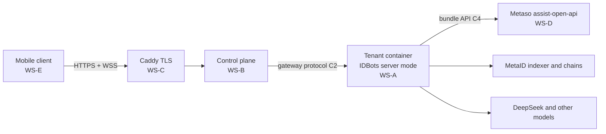

# IDBots Cloud and Mobile — Handoff Package

The continuity note for a new agent is [`HANDOFF.md`](HANDOFF.md). Read that
first. This file is the index of the package.

This folder turns the approved design
([`docs/superpowers/specs/2026-10-14-mobile-cloud-design.md`](../superpowers/specs/2026-10-14-mobile-cloud-design.md))
into documents that can be handed to separate development parties, an operations
agent, and the Metaso team. Each party gets the shared documents plus its own
workstream document, builds against the frozen interface contracts, and is
accepted against the criteria written here.

## What Is Being Built

A user downloads the IDBots app (Android APK, iPhone TestFlight, or the web
app), signs up with an invite code and a phone number, and gets a personal
cloud computer that runs the IDBots backend around the clock. The phone is a
thin client over a WebSocket gateway. One Alipay order buys a bundle that
covers both LLM usage and on-chain traffic. The first release is invite-only,
for users mainly in mainland China, hosted in Alibaba Cloud Hong Kong.

## How This Desk Works

The planning desk writes and accepts these documents. It does not implement
them. Each party below takes one implementation plan, works on its own
branch, and sends back a delivery note. Acceptance is against that party's
workstream criteria and `60-acceptance-and-go-live.md`.

M0 (GO) and M1 (contracts 1.0.0) were signed by the owner on 2026-10-15.
A party that cannot implement a frozen sentence files a change request; it
does not edit `01` or `02` on its own.

## Documents and Who Gets Them

Shared documents go to every party. The implementation plan is the document
that party starts from. The matching `10`–`50` file is the requirement spec
it has to satisfy.

| Document | Content | Give to |
|----------|---------|---------|
| [`00-program-plan.md`](00-program-plan.md) | Workstreams, dependencies, milestones, environments, change control, risks, owner decisions | Everyone |
| [`01-interface-contracts.md`](01-interface-contracts.md) | C1–C4, frozen at 1.0.0 | Everyone |
| [`02-ipc-allowlist-v1.md`](02-ipc-allowlist-v1.md) | Mobile API v1 allowlist, frozen at 1.0.0 | WS-A, WS-E, acceptance |
| [`15-ops-procurement.md`](15-ops-procurement.md) | Domain, SMS, hosts, registry, Apple, keystore, legal texts | Owner / operations |
| [`11-ws-a-implementation-plan.md`](11-ws-a-implementation-plan.md) | IDBots server mode, in branch order | IDBots development |
| [`10-ws-a-idbots-server-mode.md`](10-ws-a-idbots-server-mode.md) | WS-A requirements and acceptance | IDBots development |
| [`21-ws-b-implementation-plan.md`](21-ws-b-implementation-plan.md) | Control plane, in branch order | Control-plane development |
| [`20-ws-b-control-plane.md`](20-ws-b-control-plane.md) | WS-B requirements and acceptance | Control-plane development |
| [`31-ws-c-implementation-plan.md`](31-ws-c-implementation-plan.md) | Deploy assets and host setup, in stage order | Infrastructure engineering |
| [`30-ws-c-infra-ops.md`](30-ws-c-infra-ops.md) | WS-C requirements and acceptance | Infrastructure engineering |
| [`41-ws-d-implementation-plan.md`](41-ws-d-implementation-plan.md) | Bundle API, in stage order | Metaso team |
| [`40-ws-d-metaso-bundle.md`](40-ws-d-metaso-bundle.md) | WS-D requirements and acceptance | Metaso team |
| [`51-ws-e-implementation-plan.md`](51-ws-e-implementation-plan.md) | Mobile client, in branch order | Mobile development |
| [`50-ws-e-mobile-client.md`](50-ws-e-mobile-client.md) | WS-E requirements and acceptance | Mobile development |
| [`60-acceptance-and-go-live.md`](60-acceptance-and-go-live.md) | End-to-end scenarios, security, go-live, sign-off | Owner, acceptance, every party |
| [`delivery/internal-test-release.md`](delivery/internal-test-release.md) | Current WP0–WP3 internal-test build, canary deployment, acceptance, and rollback handoff | Operations, owner, acceptance |

Phase 0 has passed (GO, signed 2026-10-15). Its plan stays at
[`docs/superpowers/plans/2026-10-14-phase0-linux-headless-spike.md`](../superpowers/plans/2026-10-14-phase0-linux-headless-spike.md).
The results branch `spike/linux-headless` was archived by the owner on
2026-10-16 (git bundle plus the patch-series tarball, sha256
`ec684f1ce37e77e2ab38a3e9950347f8606f7950649ef5faffa48fef60c1088b`); it is
not in the repository.

## Reading Order for a New Party

1. This README and `00-program-plan.md`.
2. Your implementation plan (`11`, `15`, `21`, `31`, `41`, or `51`).
3. `01-interface-contracts.md`, the sections your plan names.
4. Your requirements file (`10` to `50`) and `60-acceptance-and-go-live.md`.

## Rules That Apply to Every Party

- Contracts in `01` and the allowlist in `02` are frozen at milestone M1. Any
  change after that goes through the change-request process in `00`.
- Work in the IDBots repository follows the repository's `AGENTS.md`: one
  branch plus one worktree per task, branched from `main`; pnpm only; commit
  messages `<type>: <short description>`; no pushes or merges to `main`
  without the owner's instruction; `pnpm run lint`, `pnpm run compile:electron`,
  `pnpm run build:skills`, and the node tests pass before a task is reported
  done.
- All code comments, documentation, and commit messages are in English. All
  user-facing strings support English and Chinese.
- User data is never deleted or reset. Database changes ship with idempotent
  first-run migrations.
- No real user mnemonics, API keys, or phone numbers in repositories, logs,
  tickets, or test fixtures.

## Status

| Item | Status |
|------|--------|
| Design spec | Approved by the owner on 2026-10-14 |
| M0 Phase 0 | GO, signed by the owner on 2026-10-15. Results archived outside the repo; see `HANDOFF.md` |
| M1 contracts | `01` and `02` frozen at 1.0.0 on 2026-10-15. Party findings come back as change requests |
| Implementation plans | Ready to hand out: WS-A, WS-B, WS-C, WS-D, WS-E, and operations |
