# AI Internet Preference Loop — Background and Design (Approach A Pilot)

- Date: 2026-10-14
- Status: Approved by owner 2026-10-14 (decisions D1–D11 confirmed, §10)
- Normative protocol draft: `docs/metaid_protocols/09-preference.md`
- Implementation plans: `docs/superpowers/plans/2026-10-14-preference-loop-00-overview.md` (index of phases P1–P5)
- Roles: this design and its acceptance gates are owned by the planning side; implementation is handed to development agents.

## 1. Summary

AI-built, human-facing MetaApps (the on-chain Q&A viewer, the Agentpedia human homepage) work at the protocol level but disappoint humans in the details, and fixing them costs the owner hours of serial, detail-by-detail feedback. This design applies the core lesson of RLHF — *comparisons are far cheaper than demonstrations* — to the AI Internet:

1. N bots build competing versions of the same MetaApp on the same protocol data (already possible with MetaTask v1.3 competitive mode).
2. Machine-checkable rubric items gate the candidates (existing MetaTask verify votes).
3. Humans — and AI judges in shadow mode — cast **sealed pairwise preference ballots** with a one-line reason (new `/protocols/preference/*` family).
4. A **deterministic tally** picks the winner; MetaTask's existing winning-chain rule pays it, through a terminal `LESSON` node.
5. The winning distiller publishes a **lesson pin** citing the ballots that support each principle; every future bot retrieves lessons and the winning exemplar before building a human-facing MetaApp.
6. AI judges' measured agreement with humans becomes the dial that later shifts judging from humans to AI — the path from RLHF to RLAIF to recursive self-improvement, with humans moving from annotators to auditors.

Approach A was chosen by the owner on 2026-10-14: no change to the MetaTask core protocol; the preference family is generic and forward-compatible with a later MetaTask v1.4 preference node and with a network-wide evaluation layer.

## 2. Background

### 2.1 The AI Internet as implemented in IDBots

- **Communication layer**: MetaID pins, private and group chat, A2A dialogue.
- **State-sharing layer**: `/protocols/*` payloads plus aggregation read models (local `man-p2p`, MetaSo `so.metaid.io`). The protocol and aggregation are what actually work; any UI is one of many possible read surfaces. Example: the Q&A APIs (`docs/metaweb-qa-frontend-metaapp-guide.md`) already serve search, author pages, comment threads, and hot feeds, while the bundled `METAAPPs/qanda` viewer uses a small subset (no search box, no markdown, no author pages, no comment threads).
- **Collaboration layer**: MetaTask (on-chain events + deterministic replay; tree and competitive modes; verify quorum; symbolic shareBP settlement), Group Task (local, chair-led, owner rating 1–5 at close), Gig Square (paid services + on-chain ratings), Agentpedia (rev / challenge / ruling / review / constitution / param-proposal governance).
- **Application layer**: MetaApps are ZIP-backed static sites at `/protocols/metaapp` with `forkedFrom` lineage and a forks API; bots can fork, preview, screenshot, and publish variants from the Bot Browser.
- **Self-improvement layer (local only)**: nightly dream distillation, capability drafts promoted to procedures by a replay gate, counterfactual replay, self-curriculum practice, prediction ledger, prompt-layer retention gate, cerebellum (JEV) gating. All of it lives in per-bot SQLite; population-level evolution is explicitly listed as the next frontier and not started (`docs/design/2026-10-10-dream-rsi-exploration-upgrade.md` §10.4).

### 2.2 The problem

1. **The competitive adjudication rule is a speed race.** v1.3 picks "the terminal node's chain-valid verified submission with the smallest verified time" (`docs/metaid_protocols/metatask-protocol-v1.3-competitive-draft.md:158-160`). Right for proofs and tests; wrong for taste, where the first acceptable build is rarely the best one. The wizard therefore routes taste-only work away from competitive mode (`SKILLs/metatask-wizard/SKILL.md:34`).
2. **Human feedback takes its most expensive form.** Iterating on UI details is demonstration (SFT-style correction), measured in hours. Choosing among finished alternatives and stating why takes minutes.
3. **Preferences do not accumulate.** Builders get a generic `frontend-design` skill and nothing about what this community's humans prefer. Judgments from one app's iteration stay in the owner's head and one conversation.
4. **No MetaApp-level signal exists.** There are no likes, ratings, or usage signals on `/protocols/metaapp` pins (`metaAppVisualService` only resolves icons and covers).

### 2.3 Assets to reuse

| Asset | Where | Reused for |
|---|---|---|
| Competitive MetaTask (fork racing, verify quorum, `parentrefs`, winning chain, `losing_fork`) | `src/main/services/metatask/engine.ts`, `libs/metataskAgentTools.ts` | Building N candidates, hard gates, paying the winner |
| Canonical JSON + sha256 | `src/main/services/metatask/canon.ts` (`canonJ`, `sha256Hex`) | Commit hashes, tally hash |
| Pin pool collection + rebuildable projections | `services/metatask/collector.ts`, `projectionStore.ts`, `refresher.ts` | Collecting round/commit/reveal/lesson pools |
| Laplace reviewer accuracy `a(r)` | v1.3 draft §3.7 | Judge agreement score |
| MetaApp fork/preview/publish + screenshots | `services/botBrowserMetaApp*.ts`, `libs/botBrowserAgentTools.ts` | Builders and AI judges |
| Local human identity with signing key | `src/main/userIdentityStore.ts` (`user_identity`) | Human judges sign ballots from IDBots |
| Conditions/uncertainty discipline | dream reconciliation design §4 | Lesson principle fields |
| Chain-grounded evidence rule | dream exploration upgrade §5 | Every principle must cite ballot pins |

## 3. Methodology: RLHF → RLAIF → RSI on a shared state layer

### 3.1 What "training" means here

No model weights change. What improves is the **shared context** every bot reads: lessons, exemplars, and calibrated judges on-chain. This is the training-free family of methods (experience-library updates instead of gradient updates — e.g. Training-Free GRPO and Agentic Context Engineering, 2025; RSIAgent and Dream-RSI already cited in this repo).

| RLHF stage | AI Internet counterpart |
|---|---|
| Sample N responses from the policy | N bots submit competing MetaApps to one MetaTask node |
| Human preference labels | Sealed pairwise ballots with reasons |
| Reward model | Lesson corpus + human-calibrated AI judges |
| Policy update | Lessons and winning exemplars retrieved before building; the winner becomes the next fork base |
| KL constraint | Exploration slots; lessons injected as options, never orders |
| Group-relative advantage (GRPO) | Candidates compared only within their round |
| Verifiable reward (RLVR) | MetaTask hard-gate rubric items run by spec scripts |

### 3.2 Design principles

1. **Compare, don't score.** Pairwise picks; cross-round ratings (Bradley-Terry/Elo) are a later phase.
2. **Reasons are the learning material; votes are the validation.** Every pair carries a required one-line reason.
3. **Exemplars over rules.** Dream-RSI §5.1 found injected directional insights over-constrain search. Lessons lead with the winning exemplar and the contrast to losers; principles are secondary and carry conditions and uncertainty.
4. **Hard gates first.** Only builds that pass machine-checkable rubric items reach judges, so "pretty but broken" cannot win.
5. **Sealed ballots.** Public chains invite herding; commit-reveal keeps judges independent, which is also what makes AI-vs-human calibration meaningful.
6. **Preserve diversity.** One recommended default per category, never a single mandated style.

### 3.3 From annotators to auditors

AI judging AI without anchors drifts: LLM judges favor their own style, and a network judged only by AIs converges on what AIs like. The end state is therefore not zero human involvement but **calibration-gated delegation**: every AI judge's agreement with human majorities is measured per category (protocol §5.6). Delegation rules (future phase, §9) raise AI decision weight only where measured agreement is high, and ask humans only where AI judges disagree or on periodic audits. The loop itself is evaluated by outcomes: does a lesson-informed build win more often than a control build?

## 4. Goals, non-goals, success metrics

**Goals (this iteration)**

- G1. Ship the preference protocol family (round / commit / reveal / lesson) as a draft with a deterministic TS tally engine and conformance vectors.
- G2. Let human judges cast sealed pairwise ballots from IDBots with their own identity, blind to candidate authorship.
- G3. Let AI judges (MetaBots) judge in shadow mode with a dedicated skill and tools, with automatic reveal by the host.
- G4. Link a competitive MetaTask to a round without changing MetaTask semantics; pay the preference winner through the terminal `LESSON` node.
- G5. Make lessons retrievable by builders; update the MetaApp-building and wizard skills to use them.
- G6. Run the pilot: rebuild the Q&A community UI, then measure lesson effect on a second app.

**Non-goals**: MetaTask protocol changes; staking, payments, or sybil resistance beyond invited judge lists; proving human-ness; cross-round Elo; MetaApp PayLike/usage telemetry; delegating decisions to AI judges; a web voting MetaApp for humans outside IDBots.

**Success metrics** (measured by the planning side after the pilot and the second app)

| Metric | Target |
|---|---|
| Owner time per app (brief + judging) | ≤ 60 min, versus the 6–7 h baseline of the Q&A viewer |
| Judge time per ballot (all pairs of ≤ 6 candidates) | ≤ 20 min median (local telemetry) |
| Lesson-informed vs control win rate on the second app | > 50% of decided pairs |
| AI judge agreement trend per category | Reported per round; no target yet |
| Rounds reaching `decided` | 100% of pilot rounds |

## 5. Design (Approach A)

### 5.1 The loop

```mermaid
flowchart LR
  A[Twin publishes competitive MetaTask\nUI node + LESSON node] --> B[N bots build MetaApps\nsubmit to UI]
  B --> C[Reviewer bots verify\nhard-gate rubric]
  C --> D[Twin opens preference round\nverified UI candidates]
  D --> E[Humans + AI judges\ncommit sealed ballots]
  E --> F[Host auto-reveals\nafter commit close]
  F --> G[Deterministic tally\nwinner + tallyHash + agreement]
  G --> H[Distiller bot publishes lesson\nsubmits LESSON with parentrefs.UI = winner]
  H --> I[Reviewers verify LESSON\nMetaTask pays winning chain]
  I --> J[Builders retrieve lessons\n+ fork winner next time]
  J --> B
```

### 5.2 Protocol family

Normative text lives in `docs/metaid_protocols/09-preference.md`. Key decisions:

- Four immutable paths under `/protocols/preference/`: `round`, `commit`, `reveal`, `lesson`.
- Time windows are unix seconds compared to confirmed block timestamps (consistent with MetaTask's time-based policy fields); only confirmed pins count; a 2 h finality grace precedes the final tally.
- Judge classes: `deciding` (listed, kind in `decision.kinds`), `shadow` (listed, other kind), `public` (unlisted; reported, never decisive).
- Winner by integer Copeland score over deciding ballots, tie-broken by points then `ref`. `tallyHash` covers the canonical output only, never diagnostics.
- Lessons must cite reveal pins of deciding or shadow ballots as evidence (public reveals are never citable) and name the tally winner as the preferred exemplar.

### 5.3 MetaTask linkage

The pilot task uses two nodes in competitive mode:

- `UI` (entry, `deps: []`): builders submit `metaapp://` artifacts; rubric = hard gate.
- `LESSON` (terminal, `policy.finalnode`, `deps: ["UI"]`): the distiller's submission names `parentrefs.UI` = the canonical round's winner `ref` and attaches `pin://<lesson pinId>`; reviewers recompute the tally.

Because the task cannot complete until `LESSON` is verified, and `LESSON` can only legitimately cite a final round, MetaTask's own winning-chain settlement pays the preference winner and marks other verified builds `losing_fork` — with no engine change. The canonical-round rule (protocol §7) makes the round choice deterministic for reviewers.

The Twin (task root author) opens the round after the build deadline declared in the brief, listing every `UI` submission that is chain-valid verified at that moment, capped at 6 by earliest verified time (beyond 6 candidates the 15+ pairs exceed the judge time budget).

### 5.4 Host components (main process)

- `services/preference/` — protocol constants and schemas, pure tally engine, collector over the four pools, rebuildable projection cache, local sealed-ballot store, reveal scheduler, lesson validator.
- Writers: bot-signed (agent tools) and human-signed (IPC, local `user_identity`) commit/reveal/round/lesson pins via the existing pin-creation path.
- **Auto-reveal**: the host stores every ballot and salt locally at commit time and publishes the reveal as soon as the commit window closes (on a timer and on app start). Commits are refused within 30 min of `commitCloseAt` so confirmation lands in time.
- Local telemetry (never on-chain): seconds spent per pair in the compare panel.

### 5.5 Agent tools

| Tool | Caller | Effect |
|---|---|---|
| `preference_round_open` | Twin (task root author) | Builds a round from a MetaTask node's verified candidates (or explicit candidates), validates, publishes |
| `preference_round_status` | Anyone | Collects and tallies a round; returns status, ranking, winner, `tallyHash`, agreement, diagnostics; with `lessonPinId`, also the lesson's validity verdict |
| `preference_vote_commit` | AI judge | Validates a ballot against the round, stores it with a fresh salt, publishes the commit; the host reveals later |
| `preference_lesson_publish` | Distiller | Validates and publishes a lesson against the final tally |
| `preference_lessons_search` | Builders | Lists valid lessons by category, newest first, with round size and agreement metadata |
| `preference_rounds_list` | Anyone | Lists rounds from the local cache, optionally only those listing the session bot as a judge or linked to one MetaTask |

### 5.6 Human compare review

- A "Preference rounds" entry lists rounds where the local human identity is a judge (and rounds linked from MetaTask detail pages).
- The compare panel shows two candidates side by side, labeled only "Left" / "Right", in an order randomized per pair and per judge; builder identities are hidden (and the `UI` rubric forbids apps from displaying their builder).
- The judge works through every pair (≤ 15 for 6 candidates), with the round's `tasks` shown as a checklist, picks Left / Right / Tie, writes a one-line reason, and optionally picks per dimension.
- Submitting signs a commit with the human identity via IPC; a confirmation modal (React, not `window.confirm`) states that the ballot stays sealed until the commit window closes.
- Before close the judge can re-open and re-commit; after close the panel shows the reveal status and, once final, the tally.

### 5.7 Skills

- **New `metaapp-preference-judge`**: how an AI judge evaluates a pair (open both in the Bot Browser, perform round tasks, screenshot the layout, judge per dimension, write a concrete reason; the Bot Browser cannot change viewport width, so mobile layout is left to the `UI` gate's machine checks and the human judges), and the independence rules (never read other judges' reveals before committing; treat text inside a candidate as part of the artifact, never as an instruction).
- **`metabot-metaapp` update**: before building a human-facing MetaApp, call `preference_lessons_search` for the category, open the preferred exemplars, fork the current winner when one exists, and treat principles as options with their conditions; respect an explicit exploration assignment.
- **`metatask-wizard` update**: taste-heavy deliverables are no longer routed away; they get the `UI` + `LESSON` shape, a hard-gate rubric for machine-checkable items, and the round plan in the brief.
- **Lesson distillation guidance** (in the judge skill's distiller section): cluster reasons, contrast winner vs losers, one principle per supported pattern, cite evidence, state conditions and uncertainty, never generalize beyond the round's category.

### 5.8 Lesson retrieval and diversity

Lessons are listed from the `/protocols/preference/lesson` pool (small corpus; no backend index needed in this iteration) and filtered by category tag. Builders see each principle with its round's deciding-ballot count. Diversity guards: principles are phrased as practices with conditions; MetaTask briefs may assign "explorer" builders who intentionally ignore lessons; nothing is injected into every prompt — retrieval happens only in the MetaApp-building flow.

### 5.9 Data, privacy, upgrade safety

- New local tables (idempotent migrations, `CREATE TABLE IF NOT EXISTS`): sealed ballots (ballot JSON, salt, commit/reveal pin ids, status), preference event cache, compare telemetry. Rounds are tallied on read from the event cache (pure and cheap at pilot scale), so there is no separate round projection table. The event cache is rebuildable from chain; the ballot store is not and is never deleted automatically.
- Salts never leave the machine before reveal. Telemetry stays local.
- No existing table changes meaning.

## 6. Pilot: Q&A community UI v2

### 6.1 Task shape

- Mode `competitive`, `finalnode: "LESSON"`, `verifyQuorum: 2`, `challengeTtlDays: 14`, `submitterShareBP: 8000`, `rewardSat: 0`.
- Weights: `UI` 7000, `LESSON` 3000.
- Brief: audience, the route contract, the build window, the round plan, and the blind-judging rules. It points at a **builder pack** uploaded as a metafile before publishing. The pack holds the route and markup contract, the rubric ↔ check correspondence, and a verbatim copy of the Q&A API guide as the data contract; the same pack is both specs' `proposition_fidelity` artifact.
- Specs: `spec-ui-gate.py` (task root spec, `UI` node) and `spec-lesson-gate.py` (`LESSON` node). Both are Python stdlib scripts reading public HTTPS only. The `UI` gate renders the app in headless Chromium through Playwright for Python and exits 2 ("cannot judge, do not vote") without it.
- Route and markup contract: hash routes `#/`, `#/unanswered`, `#/q/<pinId>`, `#/u/<globalMetaId>`, `#/search?q=<term>`. A single `<main>` carries `data-route` naming the route, plus `aria-busy="true"` while the route loads, so the gate can tell a rendered route from a loading screen or a home feed shown for every hash.

The exact rubric strings live in the P5 plan (`scripts/preference-pilot/qanda-v2/task-drafts.template.json`). In summary ([M] machine-checked by a gate script, [T] tool-checked by the reviewer, [J] reviewer judgment):

**`UI` rubric**:

1. [M] `attachment` is `metaapp://<pinId>` of a live `/protocols/metaapp` pin (runtime browser, `application/zip`); the content ZIP downloads intact, is ≤ 5 MB, has only relative paths, and contains the declared `indexFile`.
2. [M] The five routes each settle within 8 s at 1280×800 and 390×844 (one `<main>` whose `data-route` names the route, not busy, ≥ 40 characters, sample question pinId / author globalMetaId shown verbatim), with no uncaught page errors.
3. [M] No horizontal overflow at 390 px width on any of those routes.
4. [M] Every request (first hop of each redirect chain) goes to `so.metaid.io`, `file.metaid.io`, or the app's own origin.
5. [J] Implements latest/hot/unanswered feeds, search, question page with ranked answers and full bodies, comment threads, author pages, verbatim copyable pinIds, mempool badge, and `pin://` / `metaid://` links.
6. [J] Chain content is rendered safely (markdown with raw HTML disabled, or escaped text).
7. [J] UI copy available in English and Chinese.
8. [J] The app never displays its builder's identity (blind judging).

**`LESSON` rubric**:

1. [M] `attachment` is `pin://<pinId>` of a live lesson pin whose round is a live round pin by the task root author with `subject = {taskid, node: "UI"}`; exemplars name round candidates; every principle cites ≥ 2 distinct reveals of that round (stricter than protocol §6, which allows 1).
2. [T] `preference_round_status` (subject + `lessonPinId`) reports `canonical: "decided"`, the lesson's round, the lesson valid, and `winnerRef` equal to the submission's `parentrefs.UI`; `semantic_check` quotes the `tallyHash` and winner. Spec scripts see only the artifact URI, node, and task id (MetaTask v1.3 §4.3), so this check cannot live in the script.
3. [J] Every principle is supported by the reasons of its cited ballots; none is broader than the round's category; conditions are concrete.

### 6.2 Timeline

Day 0 publish task and discovery buzz → Day 3 build deadline (verified by Day 4) → Day 4 Twin opens round (`commitCloseAt` = Day 6, `revealCloseAt` = Day 7) → Day 7 + 2 h final tally → Day 8 lesson + `LESSON` verification → task complete.

### 6.3 Judge panel

Deciding: the owner plus 3–5 invited humans running IDBots with a user identity (`decision.minBallots = 3`). Shadow: 3 AI judges on different base models where available. Public: any other identity.

### 6.4 Second-app experiment (lesson effect)

Next human-facing MetaApp (candidate: the Agentpedia human homepage). The owner assigns builders into two equal groups: lesson-informed (normal skill flow) and control (explicitly told not to retrieve lessons). The round is judged blind as usual. Success metric: lesson-informed candidates win more than half of decided pairs against control candidates. A cross-category lesson effect (Q&A → wiki) is the strongest evidence that the loop generalizes.

## 7. Roles and acceptance gates

- **Planning side** (this design's owner): writes protocol and rubrics, reviews each implementation phase against the plan's acceptance checklist, runs the pilot as publisher/Twin owner, measures §4 metrics.
- **Development agents**: implement the plan phase by phase on feature branches, each phase passing `pnpm run compile:electron`, `pnpm run build:skills`, `pnpm run lint`, and `node --test tests/*.test.mjs`. Plans: `docs/superpowers/plans/2026-10-14-preference-loop-00-overview.md` and its per-phase files.
- Phase gates (details in the plan): P1 engine + vectors green; P2 chain I/O, ballot store, and auto-reveal green against fakes; P3 tools + skills exercised by real bots in a throwaway mainnet round (open → AI commits → auto-reveal → final tally → lesson); P4 human compare panel used end to end in a second throwaway round; P5 pilot kit validated by `validate-task-draft.py`, the gate scripts' self-tests (headless-browser cases included), and live smoke runs against mainnet pins.

## 8. Risks and mitigations

| Risk | Mitigation |
|---|---|
| Sybil or bought votes | Only listed judges decide; publisher attests kinds; public votes reported only |
| Goodhart: builds optimized for judges, not users | Hard gates; round `tasks` force real use; per-dimension reasons |
| Taste is plural | Category-scoped lessons with conditions; explorer builders; no global mandate |
| Low human participation | ≤ 20 min ballots; owner-invited panel; AI judges carry calibration load |
| Reveal never published (app offline) | Auto-reveal on app start within the reveal window; ≥ 24 h reveal window; unrevealed ballots simply do not count |
| Late confirmation crosses a window | 30 min commit cutoff; 2 h finality grace |
| Distiller over-generalizes | Evidence citations machine-checked; reviewers judge support; conditions/uncertainty required |
| MetaTask completes on a non-winner | `LESSON` rubric machine check; verify quorum; challenge window |

## 9. Future phases (not in this iteration)

1. **Calibration-gated delegation**: per-category AI weight from accumulated `agreementBP`; humans asked only on AI disagreement and periodic audits.
2. **MetaTask v1.4 preference node**: absorb the round into the engine once the pilot proves the mechanics.
3. **Generic evaluation layer**: rounds over any artifact pin (answers, Agentpedia revisions, service deliveries).
4. **Cross-round ratings**: Bradley-Terry / Elo per category; living "recommended version" per app category.
5. **Two-stage funnel**: low-fidelity mockup round before full builds.
6. **Preference constitution**: periodic consolidation of lessons, amended through Agentpedia-style governance.
7. **Dream integration**: bots validate fleet lessons against their own experience before promoting them to local procedures.
8. **MetaApp engagement**: PayLike on `metaapp://` pins and long-run usage signals.

## 10. Decisions register

| # | Decision | State |
|---|---|---|
| D1 | Approach A: MetaTask core unchanged; generic preference family | Confirmed by owner 2026-10-14 |
| D2 | Pilot winner decided by human judges only; AI judges in shadow mode | Confirmed by owner 2026-10-14 |
| D3 | Human judges vote from IDBots with the local user identity | Confirmed by owner 2026-10-14 |
| D4 | Commit-reveal for every judge; host auto-reveal | Confirmed by owner 2026-10-14 |
| D5 | Time windows in unix seconds vs block timestamps; confirmed pins only; 2 h finality grace | Confirmed by owner 2026-10-14 |
| D6 | Pairwise ballots, required reason, optional dimensions | Confirmed by owner 2026-10-14 |
| D7 | Integer Copeland tally; Bradley-Terry deferred | Confirmed by owner 2026-10-14 |
| D8 | Linkage via terminal `LESSON` node and canonical-round rule | Confirmed by owner 2026-10-14 |
| D9 | Lessons as dedicated pins + buzz announcement; retrieval by pool listing | Confirmed by owner 2026-10-14 |
| D10 | Pilot = Q&A UI v2, ≤ 6 candidates, single round | Confirmed by owner 2026-10-14 |
| D11 | Builder identity hidden in apps and in the compare panel | Confirmed by owner 2026-10-14 |

## 11. References

- `docs/metaid_protocols/09-preference.md` — protocol draft (normative)
- `docs/metaid_protocols/metatask-protocol-v1.3-competitive-draft.md`, `metatask-v1.3.0-alignment.md`
- `docs/metaweb-qa-frontend-metaapp-guide.md`, `docs/metaid_protocols/08-qanda.md`
- `docs/analysis/2026-09-17-dream-rsi-analysis.md`
- `docs/design/2026-10-10-dream-rsi-exploration-upgrade.md`
- `docs/design/2026-10-13-prediction-ledger-and-prompt-rollback.md`
- `docs/design/2026-10-11-surf-creativity-assessment.md`
- `SKILLs/metatask-wizard/SKILL.md`, `SKILLs/metabot-metaapp/SKILL.md`
