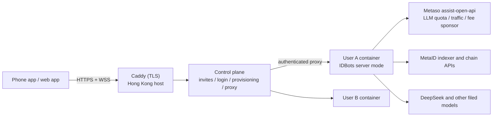

# Mobile Access via Cloud-Hosted IDBots — Design

Date: 2026-10-14
Status: Approved by the owner on 2026-10-14
Scope: First invite-only release that lets a user install a phone app and use
IDBots without owning an always-on computer
Handoff: the per-party requirement documents are in
[`docs/cloud-mobile/`](../../cloud-mobile/README.md); the Phase 0 spike plan is
[`docs/superpowers/plans/2026-10-14-phase0-linux-headless-spike.md`](../plans/2026-10-14-phase0-linux-headless-spike.md).
Where this spec and those documents differ, the documents are newer and win.

## Summary

Each user gets one cloud container that runs the existing IDBots backend in a
new headless "server mode". A small control plane handles invites, login,
container provisioning, and connection routing. The phone app is a thin client
that talks to the user's own container through an allowlisted WebSocket bridge
over the existing IPC surface, so the mobile UI can reuse the renderer's
services, Redux slices, and many components. Billing reuses Metaso's
`assist-open-api` accounts (LLM quota, traffic bytes, Alipay recharge) with one
new "bundle" product.

This is the same "one persistent cloud computer per user" model used by Meta
Muse, OpenAI Dots, Manus Cue, and Grok Bot. Scaling means adding hosts, not
rewriting the backend.

## Owner Decisions (2026-10-14)

1. **First users and distribution:** invite-only, users mainly in mainland
   China. Distribution through a web app (PWA), TestFlight, and a directly
   downloaded Android APK. No public app-store listing in this release.
2. **Demo scope:** chat with a MetaBot that uses skills; background work
   (scheduled and long-term tasks keep running while the phone is closed);
   one recharge covering LLM and on-chain traffic; creating and managing
   MetaBots; on-chain social (Buzz, private chat, Gig Square hire/accept);
   multi-bot group tasks. Excluded: Bot Browser, phone-to-own-desktop remote.
3. **Approach:** remote IPC bridge plus renderer reuse (Approach A below),
   with a chat-first mobile UI.
4. **Metaso backend:** owned by the team; it will add the bundle product.
5. **Custody:** cloud-held Bot keys are accepted for this release, with small
   balances and a self-custody exit (mnemonic export plus chain restore).

## Goals

- A new user goes from invite code to a working MetaBot on the phone with no
  computer, no API key, and no wallet setup.
- MetaBots keep working (scheduled tasks, long-term tasks, private-chat
  listening, group tasks) while the phone app is closed.
- One Alipay purchase funds both LLM usage and on-chain traffic.
- Reuse the existing backend and renderer logic instead of re-implementing
  features for mobile.
- Keep desktop IDBots behavior unchanged.
- Show investors and partners an architecture whose scale-out path is adding
  hosts.

## Non-goals

- Multi-tenant backend (many users in one process or one database).
- Removing Electron from the server runtime.
- Push notifications, idle sleep/wake, multi-host scheduling.
- Bot Browser or computer-use on mobile.
- Connecting the phone to a user's own desktop IDBots.
- Mainland-region hosting, APP filing, generative-AI service filing, and
  public app-store listing. All are required before a public launch, not for
  this release.
- Per-field KMS encryption of mnemonics.

## Competitive Context

| Product | Where the agent runs | Mobile |
|---|---|---|
| Meta Muse (2026-09-08) | Dedicated secure VM per user holding agent and data | iPhone app, WhatsApp, web, Mac |
| OpenAI Dots (2026-09-29) | Own cloud computer per dot | ChatGPT mobile/desktop, Slack, Teams |
| Manus Cue (2026-09-28) | Each agent has email, phone number, wallet, computer | iOS, Android, desktop (invite-only) |
| Grok Bot | One persistent cloud computer per account | Desktop plus iOS/Android companion |

All four keep the agent in the cloud and treat the phone as a client. Cue's
"each agent has a wallet" is close to the MetaBot identity-plus-wallet model.

## Current-State Constraints

- **Single tenant per install.** One `idbots.sqlite` per userData directory;
  `user_identity` is constrained to one row (`CHECK (id = 1)` in
  `sqliteStore.ts`). The natural cloud unit is one container per user.
- **Agent execution does not need a window.** The DSH kernel is a separate
  Node child process over stdio JSON-RPC (`src/main/libs/dshKernel/`), spawned
  with `ELECTRON_RUN_AS_NODE=1`. Electron mainly provides process hosting,
  paths (`app.getPath`), and Chromium networking (`session.fetch`) for the
  local OpenAI-compatible proxy.
- **Electron is woven through the main process.** 46 files under `src/main`
  import `electron`. Stripping it is out of scope; the server runs the same
  Electron binary without a window.
- **No remote API exists.** The renderer reaches main through 341
  `ipcMain.handle` channels; streaming and state events go out through about
  50 `BrowserWindow.getAllWindows()` / `webContents.send` broadcast sites. All
  HTTP servers (MetaID RPC on `127.0.0.1:31200`, the cowork proxy, the MetaApp
  server) bind loopback only.
- **An external-channel pattern already works.** `src/main/im/imCoworkHandler.ts`
  drives cowork sessions from IM conversations, including text-based tool
  permission approval.
- **Unattended sessions already have a policy.** `coworkRunner.ts` handles
  `autoApprove` / `bypassPermissions` / `acceptEdits` sessions without
  prompts and with restricted deletes.
- **Billing building blocks exist at Metaso `assist-open-api`.**
  Identity-signed accounts, free LLM quota relay (`llmRelayService.ts`),
  byte-metered traffic accounts with Alipay/PayPal recharge and campaign
  redeem (`trafficAccountService.ts`), and MVC fee sponsorship
  (`mvcSponsorClient.ts`).
- **Keys are plaintext in SQLite.** `metabot_wallets.mnemonic` and
  `user_identity.mnemonic` are stored unencrypted. Hosting them makes the
  service custodial.
- **A self-custody exit is already designed.**
  `docs/design/2026-10-10-chain-backup-restore-design.md` targets moving a
  Bot fleet to "a future cloud version of IDBots" with only the user mnemonic.
- **The renderer calls `window.electron` directly** in 94 files, and
  `preload.ts` is a thin method-to-channel mapping. A WebSocket implementation
  of the same interface lets most renderer logic run unchanged.
- **Desktop-only subsystems:** tray, auto-update, auto-launch, sleep guard,
  screenshots (`desktopCapturer`), and Bot Browser webviews. Bundled ffmpeg
  exists only for darwin-arm64 and win32-x64. The bundled `man-p2p` indexer
  has already been removed; indexer reads go to the remote indexer unless
  `IDBOTS_MAN_P2P_LOCAL_BASE` points at a self-hosted one.

## Approaches Considered

- **A. Remote IPC bridge plus renderer reuse (chosen).** Allowlisted
  WebSocket gateway over the existing IPC handlers; a `window.electron`
  shim on the phone. Highest reuse; the IPC surface needs an allowlist and
  auth because it was not designed as a public API. Rough estimate: 5–7
  weeks to invite-only use with 1–2 engineers plus AI.
- **B. New mobile API plus React Native app.** Cleanest contract and best
  native feel, but every feature area needs a new API and new UI, roughly
  2–3x the work of A (3–4 months), with a risk of duplicating logic next to
  the IPC handlers.
- **C. Chat-only channel.** The app is an IM-style channel reusing the
  `IMCoworkHandler` pattern; everything else goes through agent tools. Fastest
  (3–4 weeks) but has no structured screens, spends LLM quota on every action,
  and shows less platform depth.

Rejected outright: streaming the desktop UI to the phone (poor mobile UX,
heavy), and a multi-tenant rewrite (too large for the team; also unnecessary,
since the competitors run one machine per user).

## Architecture

- **Hosting:** one Hong Kong cloud host (Alibaba Cloud or Tencent Cloud),
  starting at 8 vCPU / 32 GB. Hong Kong reaches both domestic services
  (DeepSeek, Alipay, Feishu, DingTalk) and overseas ones (GitHub skill
  downloads), needs no ICP filing for the web domain, and has acceptable
  latency for mainland users.
- **Entry:** Caddy terminates TLS only. The control plane serves the login
  page and is the WebSocket/HTTP proxy to tenant containers.
- **Tenant containers:** one per user, on an internal Docker network with no
  published ports. Each mounts its own data volume, which holds exactly what
  a desktop userData directory holds today (`idbots.sqlite`, skills,
  workspaces). Memory limit per container (initially 1.5 GB). Docker restart
  policy restarts crashed containers.
- **Always on:** all tenant containers stay running in this release because
  background work needs them.
- **Shared services:** indexer reads go to the remote indexer, as on desktop
  since `man-p2p` was removed. LLM, traffic, and fee sponsorship go through
  Metaso.
- **Upgrade:** the control plane restarts a tenant on a new image tag; the
  data volume persists, and the existing idempotent first-run migrations run
  exactly as they do after a desktop auto-update.
- **Backups:** daily snapshots of tenant volumes to object storage.
- **Scale-out:** add hosts; the control plane records which host each tenant
  lives on. A later move to Kubernetes or a similar orchestrator does not
  change the tenant image.

## Control Plane

A new small Node/TypeScript service in `cloud/control-plane/`, packaged as its
own pnpm package (same pattern as `dsh-runtime/`), with SQLite storage.

**Accounts and login**

- Sign-up requires an invite code and a phone number; login uses an SMS code
  (Alibaba Cloud SMS; the signature and template need a few business days of
  approval under the company entity).
- On login the control plane issues an opaque session token. The phone holds
  only this token.

**Provisioning**

1. After the invite code validates, the control plane creates a container
   from `idbots-server:<version>` through the Docker Engine API, mounts the
   user's volume at `/data`, and injects `IDBOTS_SERVER_MODE=1`,
   `IDBOTS_USER_DATA_PATH=/data/userdata`, and a per-container gateway secret
   (full list in `docs/cloud-mobile/01-interface-contracts.md`, C1).
2. On first boot, server mode runs the onboarding a desktop user does by
   hand: create the user identity, create the first twin MetaBot (reusing
   `welcomeBootstrap.ts`), select the Metaso relay as the LLM provider, and
   set the fee mode to traffic sponsorship.
3. The app shows a "preparing your Bot" state while the control plane polls
   the container health endpoint, then enters the main UI.

**Proxying**

- The control plane validates the session token, looks up the tenant
  container, and proxies the WebSocket and HTTP requests, adding the
  container's gateway secret upstream.
- After login, the mobile web bundle is served from the user's own container
  through this proxy, so the UI version always matches the backend version.

**Data** (three tables)

- `users`: phone, invite code used, tenant id, timestamps.
- `tenants`: host, container id, image tag, status, gateway secret.
- `invites`: code, max uses, used count, optional traffic campaign code.

Balances are not stored in the control plane; Metaso is the source of truth.

**Admin:** command-line scripts for list, restart, upgrade, and export in this
release.

## Billing

- **Traffic:** balance, ledger, pricing, and Alipay recharge already exist in
  `trafficAccountService.ts` with 18 IPC handlers; the phone calls them
  through the bridge unchanged.
- **LLM:** new users start on Metaso's existing free quota. Metaso adds a
  **bundle** product: one Alipay order credits both traffic bytes and LLM
  quota on the same identity-bound account. The app shows one bundle with two
  meters. This is the only Metaso backend change in this design.
- **Invites:** an invite code can carry an existing traffic campaign redeem
  code so new users start with trial traffic.
- **Hosting cost:** containers are free to users in this release. At 20–40
  users per host, the hosting cost is roughly tens of RMB per user per month;
  it must be priced into bundles or a membership before a public launch.

## Tenant Server Mode and Remote Gateway

**Server mode (`IDBOTS_SERVER_MODE=1`)**

- Creates no window, and the process does not quit when no windows exist.
- Skips tray, auto-update, auto-launch, and sleep guard.
- Disables Bot Browser and screenshot tools.
- Linux display strategy (Xvfb or Chromium's headless Ozone platform) is
  decided in Phase 0.
- Desktop builds do not set the flag and behave exactly as today.

**IPC registry**

- Add `registerIpcHandler(channel, fn)`, which calls `ipcMain.handle` and
  records `fn` in a registry map. Replace the 342 `ipcMain.handle`
  registrations: 312 in `main.ts` and 30 in five service modules
  (`trafficAccountService`, `metabotWalletIpc`, `feeRateStore`,
  `llmRelayService`, `jevRelayService`).
- The 24 `event.sender` / `BrowserWindow.fromWebContents` uses are reviewed
  individually; most are window controls that never enter the allowlist.

**Event broadcast**

- Add `broadcastToRenderers(channel, payload)`, which sends to all windows
  (desktop) and to connected gateway clients (server mode). Replace the
  existing `getAllWindows()` / `webContents.send` broadcast sites.

**Gateway protocol**

- A WebSocket server on the container's internal interface, enabled only in
  server mode.
- Client to server: `{ type: 'invoke', id, channel, args }`. Server to client:
  `{ type: 'result', id, ok, value | error }` and
  `{ type: 'event', channel, args }`. The full protocol (welcome frame, error
  and close codes, limits) is C2 in `docs/cloud-mobile/01-interface-contracts.md`.
- Payloads pass through the existing `sanitizeIpcPayload` limits.
- Reconnects reuse the existing stream resync path
  (`readCoworkStreamLiveContent`), so a reply that was streaming when the
  phone went to the background is reassembled on return.
- HTTP routes: signed file download restricted to the tenant data directory
  (replaces `file://` on mobile), and attachment upload (photos from the
  phone).

**Allowlist**

- Channels grouped by feature: cowork sessions and messages, MetaBot
  management, skills, scheduled and long-term tasks, traffic and LLM quota,
  Gig Square, Buzz and private chat, group tasks.
- Deny by default. Never allowed: file/folder dialogs, open-folder and
  shell-open calls, window controls, app update, log folder.
- A test asserts that every allowlisted channel exists in the registry.

**Authentication**

- The container rejects connections without its gateway secret. Only the
  control plane knows the secret; the phone never sees it.
- No tenant port is reachable from the internet.

**Tool permission approval**

- Phone connected: permission requests reach the phone as events and are
  answered in a bottom sheet through the existing response channel.
- Phone disconnected: background sessions follow the existing unattended
  policy and never block. A user-started conversation waiting on a
  permission waits for the user to return, or the user can answer through a
  configured Feishu or DingTalk channel via the existing text relay.

## Security and Custody

- No schema change in this release; mnemonics stay in the tenant's SQLite on
  the tenant's volume, stored on the cloud provider's encrypted disks.
- Fees go through traffic sponsorship, so Bot wallets do not need to hold
  funds; balances stay small.
- Mnemonic export is a dedicated HTTP route, never a WebSocket channel: the
  control plane requires a fresh SMS verification and then calls the tenant's
  sensitive route with a short-lived, single-use token. The exported mnemonic
  can be imported
  into desktop IDBots and restored through the chain backup design, which is
  the self-custody exit.
- Operator access to tenant volumes is restricted and logged. The privacy
  policy states that the service is custodial.

## Mobile Client

**Location**

- Same repository, new Vite entry `src/mobile/`, importing renderer code
  through the `@/` alias.
- Shares `i18n.ts`, CSS theme variables, and the Tailwind config, so English
  and Chinese copy and light/dark themes stay consistent.

**`window.electron` shim**

- The desktop preload runs sandboxed and cannot import shared modules, so it
  stays the source of truth: a script parses `preload.ts` into a contract
  file (method path, channel, kind) that the mobile shim is built from, and a
  test fails when the file is stale, so the two cannot drift.
- The shim handles reconnects and request timeouts and shows a reconnecting
  banner.
- Add `resolveLocalFileUrl()`: `file://` on desktop, signed gateway URL on
  mobile. Renderer components that use local file paths (about 20, e.g.
  `MarkdownContent`) call it.

**UI (chat-first, four bottom tabs)**

- **Chat:** home screen, assistant-mode bubbles, Bot switcher at the top,
  permission approval in a bottom sheet (no `window.confirm`).
- **Tasks:** scheduled, long-term, and group tasks with progress.
- **Square:** Gig Square (hire, accept, orders) and Buzz.
- **Me:** MetaBot management (create, persona, skills, model), bundle
  balance and Alipay recharge, mnemonic export, settings.

Logic is reused; presentation is rewritten or made responsive for phone
sizes. Wide desktop modals such as `GigSquareOrderModal` become full-screen
pages.

**Packaging and distribution**

- **Web:** login page from the control plane; the app bundle from the user's
  container.
- **Android:** Capacitor APK whose shell loads the remote page, distributed
  by download link or QR code. Native plugins: camera/photos and system share
  only.
- **iPhone:** seed users use the web app (Add to Home Screen); investors and
  core partners use the same Capacitor shell through TestFlight. Risk: a
  future App Store submission may be rejected as a thin web wrapper
  (guideline 4.2) and will need native features; this does not affect the
  invite-only release.
- **No background push in this release.** Domestic Android lacks FCM; a
  domestic push provider is a later phase.

## Evolution Path to a Native App

Moving later to "new mobile API plus React Native" is an evolution, not a
rewrite. The cloud side (control plane, tenant containers, gateway protocol,
auth, billing), about 60–70% of the work, stays unchanged. What is redone is
the UI layer: React Native cannot render the DOM components or Tailwind DOM
styles (NativeWind eases the styling port), and Markdown rendering and stream
display need native implementations. Redux slices and services carry over
largely as-is. The cost is roughly re-building the phone UI, far less than
Approach B from scratch.

Constraints this release follows to keep that path cheap:

1. The gateway protocol (`invoke`, `event`, signed file URLs) is
   client-agnostic; a native app speaks the same protocol.
2. The allowlist plus the typed contract table is version 1 of the mobile
   API and is maintained with a version number.
3. Mobile business logic lives only in services, slices, and hooks;
   components only render.
4. When an IPC channel is too coarse or too chatty for mobile, add a
   dedicated `mobile:*` facade channel in the main process that composes
   existing stores and services. Over time these facades become the clean
   Approach B API, replaced incrementally.

A gentler intermediate step is Expo DOM components: a React Native shell that
embeds the existing web screens and swaps them for native screens one at a
time.

## Phased Plan

Estimates assume 1–2 engineers plus AI and are recalibrated after Phase 0.
Each phase gets its own implementation plan; Phase 0 is planned first, and
later plans incorporate its measurements.

**Phase 0 — Technical spike (about 1 week)**

- Build a Linux x64 image with Electron, `dsh-runtime/`, `SKILLs/`, Python,
  Linux ffmpeg, and Playwright Chromium.
- Start headless; run one chat turn with a skill, one scheduled task, and
  one traffic-sponsored chain write.
- Measure idle memory, peak memory during a turn, and cold start time.
  Verify document skills (docx/pdf/pptx/xlsx) and DSH kernel patches on Linux.
- Exit: go/no-go and a measured users-per-host number.

**Phase 1 — Minimum loop (about 2–3 weeks)**

- Server mode; IPC registry and broadcast refactor; gateway, allowlist, and
  file routes for chat, MetaBot management, skills, scheduled and long-term
  tasks, balance and recharge.
- Control plane: invites, SMS login, provisioning, proxy.
- Mobile web: Chat, Me, and Tasks tabs.
- In parallel: Metaso bundle product.
- Demo script: sign up with an invite code, Bot ready, chat that uses a
  skill, create a scheduled task, close the phone, reopen and see the result,
  recharge with Alipay.

**Phase 2 — Full demo scope (about 2 weeks)**

- Gig Square, Buzz, private chat, and group tasks in the allowlist with
  mobile screens.
- Capacitor APK and TestFlight builds.
- Mnemonic export with SMS re-verification; daily volume snapshots; admin
  scripts.

**Later (outside this spec):** push notifications, idle sleep/wake, multi-host
scheduling, phone-to-own-desktop relay, Bot Browser streaming, KMS mnemonic
encryption, mainland hosting and public listing compliance.

## Resources

- One Hong Kong cloud host (8 vCPU / 32 GB to start), object storage, a
  domain.
- Alibaba Cloud SMS (signature approval required).
- Apple Developer account (TestFlight) and an Android signing key.
- One Metaso backend engineer for the bundle product.

## Risks and Mitigations

| Risk | Mitigation |
|---|---|
| Electron headless or skills fail on Linux | Phase 0 validates before any other work |
| Per-tenant memory above estimate | Playwright off by default, lower container limits, bring idle sleep forward |
| Desktop-only channel slips into the allowlist | Reviewed allowlist plus registry-existence test |
| Desktop regression from the registry/broadcast refactor | Mechanical replacement, identical desktop behavior, full existing test suite |
| Custody and compliance exposure | Invite-only, small balances, explicit privacy policy, self-custody exit |
| Hong Kong to mainland network instability | Acceptable for the demo; mainland region for public launch |

## Testing

- **Unit:** gateway auth and allowlist; the contract file generated from the
  preload is current and the shim covers it; signed file URLs cannot escape
  the tenant data directory (path traversal).
- **Integration:** docker-compose with the control plane and two tenants; a
  script runs sign-up, provisioning, a chat turn, a scheduled task firing,
  and a mid-stream reconnect.
- **Desktop regression:** `pnpm run compile:electron`,
  `pnpm run build:skills`, `pnpm run lint`, and
  `node --test tests/*.test.mjs`, as in the existing pre-commit verification.
- **Devices:** iPhone Safari web app; Android APK on domestic phones
  (Huawei, Xiaomi) for WebView compatibility.
